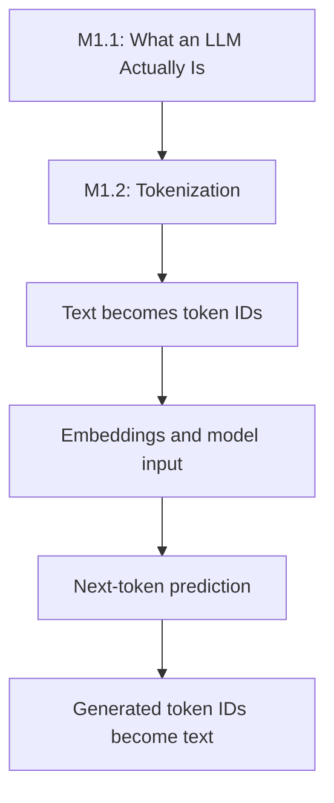
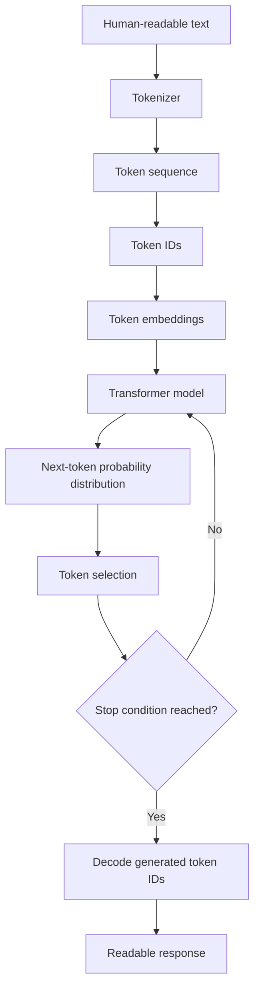
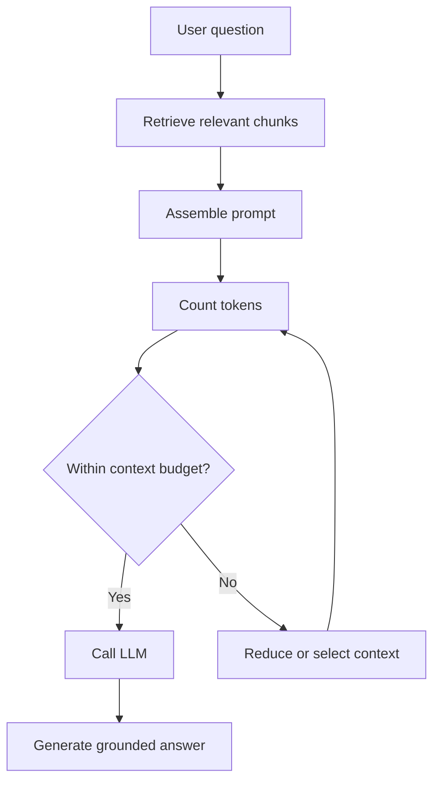

- **Module ID:** M1.2
- **Module:** Tokenization
- **Category:** Theory + Coding
- **Coding Requirement:** Light
- **Difficulty:** Beginner
- **Importance:** Core
- **Estimated Study Time:** 3–4 hours
- **Prerequisites:** Basic text processing, familiarity with LLMs and next-token prediction (M1.1), and basic Python.

# M1.2 — Tokenization

Tokenization is the process of converting text into smaller units called *tokens* that a language model can process. Understanding tokenization is essential for AI Engineering because it influences how text is represented, how much context an LLM can accept, how API usage is billed, and how models handle languages, code, numbers, and unusual spellings.

This module develops a practical understanding of tokenization, from characters and words to token IDs, with hands-on comparisons across English, Hindi, Devanagari, source code, emojis, and numerical data.

## Table of Contents

1. [Overview and Learning Objectives](#1-overview-and-learning-objectives)
2. [Core Concepts and Fundamentals](#2-core-concepts-and-fundamentals)
3. [Architecture, Workflow, and Internal Mechanics](#3-architecture-workflow-and-internal-mechanics)
4. [Techniques, Methods, and Practical Patterns](#4-techniques-methods-and-practical-patterns)
5. [Code and Hands-On Implementation](#5-code-and-hands-on-implementation)
6. [Real-World Applications and Engineering Decisions](#6-real-world-applications-and-engineering-decisions)
7. [Common Mistakes, Misconceptions, and Troubleshooting](#7-common-mistakes-misconceptions-and-troubleshooting)
8. [Interview Preparation and Knowledge Validation](#8-interview-preparation-and-knowledge-validation)
9. [Revision, Exercises, and Completion Checklist](#9-revision-exercises-and-completion-checklist)
10. [References](#10-references)

---

## 1. Overview and Learning Objectives

### 1.1 What is tokenization?

Tokenization is the process of splitting an input sequence into tokens according to a tokenizer's vocabulary and rules.

For example, a tokenizer might represent:

```text
Input:     Tokenization is important.
Tokens:    ["Token", "ization", " is", " important", "."]
Token IDs: [example_id_1, example_id_2, example_id_3, example_id_4, example_id_5]
```

The tokens and IDs above are illustrative, not the output of a particular tokenizer.

A token can represent a whole word, part of a word, punctuation, whitespace combined with text, a special symbol, or another unit defined by the tokenizer. Tokens are not necessarily words or individual characters.

### 1.2 Why tokenization matters in AI Engineering

Tokenization is the bridge between human-readable input and the numerical representation used by an LLM.

It affects:

- **Input representation:** How text becomes token IDs.
- **Context windows:** How much conversation, documentation, or retrieved information fits into a model's context limit.
- **API costs:** How many billable input and output tokens a request consumes.
- **Latency:** How input processing and token-by-token output generation affect response time.
- **Multilingual behavior:** How efficiently different languages are represented.
- **Code understanding:** How programming syntax, identifiers, and punctuation are divided.
- **Numerical reasoning:** How numbers are represented and processed.
- **Text limits:** Why character counts and word counts cannot reliably predict token counts.

### 1.3 Learning objectives

By completing this module, you should be able to:

1. Distinguish characters, words, tokens, and token IDs.
2. Explain why LLMs operate on token IDs rather than directly processing ordinary text.
3. Describe how a tokenizer maps text to tokens and IDs and reconstructs text from token sequences.
4. Explain why the same text can be tokenized differently by different tokenizers.
5. Compare tokenization of English, uncommon words, numbers, source code, emojis, Devanagari text, and mixed Hindi-English text.
6. Explain the relationship between token count, API pricing, context windows, output length, and latency.
7. Identify why spelling changes, character counting, and numerical representation can produce surprising tokenization behavior.
8. Write a Python program to compare token counts across different text categories.
9. Estimate the token-related impact of prompts, retrieved documents, and generated responses in an LLM application.

### 1.4 Prerequisites and setup

No GPU, paid API, or LLM training is required.

For the hands-on section, use Python 3.10 or newer and install the `tiktoken` library:

```bash
python -m pip install tiktoken
```

This library provides encodings used by certain OpenAI models. Its output is not a universal token count for every LLM.

### 1.5 Roadmap connection



Tokenization builds on the next-token prediction concept from M1.1. It also prepares you for embeddings, transformer architecture, context-window management, and LLM API usage.

---

## 2. Core Concepts and Fundamentals

### 2.1 Characters, words, tokens, and token IDs

These four concepts describe different levels of text representation.

| Concept | Meaning | Example |
|---|---|---|
| Character | A unit of text representation; the exact definition depends on the text system | `c`, `a`, `t` |
| Word | A linguistic unit separated according to language and writing conventions | `cat` |
| Token | A unit produced by a particular tokenizer | `cat`, ` ca`, `t`, depending on the tokenizer |
| Token ID | An integer representing a token in a tokenizer's vocabulary | `12345`, as an illustrative ID |

Consider the sentence:

```text
AI engineers build useful tools.
```

- Characters are the individual text symbols and spaces.
- Words are `AI`, `engineers`, `build`, `useful`, and `tools`.
- Tokens are the units selected by the tokenizer.
- Token IDs are the numerical identifiers associated with those tokens.

The number of characters, words, and tokens will generally differ.

A Unicode character also does not always correspond to one byte or one user-perceived symbol. For example, some accented letters and emoji sequences are composed of multiple Unicode code points. This is one reason character counting is not a reliable substitute for token counting.

### 2.2 What exactly is a token?

A token is a unit in a tokenizer's vocabulary.

Depending on the tokenizer, a token may correspond to:

- A common whole word.
- A frequent word fragment.
- A prefix or suffix.
- Punctuation.
- A whitespace-prefixed word or fragment.
- A number fragment.
- A piece of source code.
- A special control token.

For example, the uncommon word:

```text
uncharacteristically
```

could be represented as one token or several subword tokens, depending on the tokenizer.

A different tokenizer may divide it into different fragments. The exact split must be checked with the tokenizer being used.

**Important distinction:** A token is a model's text-processing unit, not necessarily a meaningful linguistic unit.

### 2.3 Why LLMs operate on tokens

Neural language models operate on numerical representations. They cannot directly use an ordinary Python string as their underlying sequence of discrete vocabulary symbols.

A typical text-generation model uses this conceptual process:

1. Receive text.
2. Tokenize the text.
3. Convert tokens to token IDs.
4. Map IDs to learned vector representations.
5. Process those representations through the model.
6. Predict a probability distribution over possible next tokens.
7. Select or sample a token according to the generation configuration.
8. Repeat until generation stops.
9. Convert the generated token sequence back into readable text.

The model does not normally search a dictionary for a stored answer. Tokenization creates the discrete input sequence the model processes.

### 2.4 What is a tokenizer vocabulary?

A tokenizer vocabulary is the collection of token units that a tokenizer can represent.

Each token has an associated ID within that tokenizer's vocabulary.

For example, a hypothetical vocabulary could contain:

| Token | Illustrative ID |
|---|---:|
| `cat` | 101 |
| ` dog` | 102 |
| `ing` | 103 |
| `.` | 104 |

These IDs are examples only. Actual IDs depend on the vocabulary and encoding.

The vocabulary is not the same thing as a dictionary of complete words. Many tokenizers include subword units so that less common words can be represented by combinations of smaller units.

### 2.5 How token IDs become model inputs

Token IDs are discrete identifiers, not numerical measurements of meaning.

For example, ID `102` is not twice as meaningful as ID `51`. The numerical IDs identify vocabulary entries.

A model typically uses an embedding matrix to map each token ID to a learned vector:

$$
\mathbf{e}_i = E[i]
$$

where:

- $i$ is a token ID.
- $E$ is the embedding matrix.
- $E[i]$ is the vector associated with that token.

The resulting vector is used as part of the model's input representation. Transformer models also incorporate information about token positions.

The token ID identifies a token; its learned embedding provides a numerical representation that the model can use to process it.

### 2.6 Why different tokenizers split the same text differently

Tokenization depends on the tokenizer's design, vocabulary, normalization rules, and segmentation algorithm.

Different tokenizers may vary in:

- Vocabulary size and contents.
- Which word fragments are common enough to receive their own tokens.
- How whitespace and punctuation are represented.
- How Unicode text is normalized or encoded.
- How numbers and code are segmented.
- Whether and how special tokens are handled.

Suppose two tokenizers process:

```text
unbelievable
```

A hypothetical comparison might look like this:

```text
Tokenizer A: ["un", "believable"]
Tokenizer B: ["un", "believ", "able"]
```

These are illustrative splits, not guaranteed outputs.

Neither tokenizer is automatically wrong. Each applies its own rules and vocabulary.

**Engineering rule:** When working with a particular model, use its documented tokenizer or official token-counting method whenever available.

### 2.7 Subword tokenization

Subword tokenization represents text using units smaller than some words but often larger than individual bytes or characters.

It offers a compromise between whole-word tokenization and character-level tokenization.

#### Whole-word tokenization

A whole-word tokenizer attempts to assign vocabulary entries to complete words.

Advantages:

- Common words may require only one token.
- The representation can be intuitive.

Limitations:

- Uncommon words create vocabulary problems.
- New words and spelling variations may be difficult to represent efficiently.
- The vocabulary can become very large.

#### Character-level tokenization

A character-level tokenizer represents text using individual character units or an equivalent character-based representation.

Advantages:

- Can represent unfamiliar spellings using known character units.
- Avoids requiring every complete word to be in the vocabulary.

Limitations:

- Text sequences can become long.
- A model may need more positions to represent the same text.

#### Subword tokenization

Subword methods learn or define reusable units from text.

Advantages:

- Frequent words and fragments can be represented efficiently.
- Uncommon words can often be decomposed into known pieces.
- The vocabulary can be more manageable than a vocabulary of all possible words.

Limitations:

- Splits may not align with linguistic boundaries.
- Different tokenizers can produce different counts.
- Rare or unusual text may still require many tokens.

### 2.8 Bytes, Unicode, and characters

A computer stores text using an encoding such as UTF-8. UTF-8 represents Unicode code points using one to four bytes per code point.

This creates several distinct quantities:

- **Bytes:** Encoded storage units.
- **Unicode code points:** Individual code points in a text string.
- **Grapheme clusters:** Units that approximate user-perceived characters.
- **Tokens:** Units selected by the tokenizer.

These quantities are not interchangeable.

For example, a Devanagari character with combining marks may contain multiple code points. An emoji with a skin-tone modifier or a joined family emoji may contain multiple code points and bytes.

Therefore:

$$
\text{bytes} \neq \text{characters} \neq \text{tokens}
$$

This is a conceptual inequality, not a claim that the counts must always differ. Sometimes two counts happen to be equal.

### 2.9 Tokenization across languages and writing systems

Tokenization quality can vary across languages because tokenizers are built using particular vocabularies, training data, and segmentation rules.

A tokenizer that represents common English text efficiently may divide some other languages into more tokens for the same amount of text.

This can affect:

- The number of tokens required for a translation.
- How much multilingual content fits into a context window.
- The cost of multilingual API requests.
- The amount of generated text possible within a token limit.
- The representation of mixed-language conversations.

This does not mean every non-English sentence always uses more tokens than an English translation. Actual counts depend on the exact text, tokenizer, language, and writing system.

#### English

Common English words and phrases may be represented efficiently when they are well represented in the tokenizer vocabulary.

Uncommon words, invented words, unusual capitalization, and misspellings may split into more pieces.

#### Hindi and Devanagari

Hindi is commonly written in Devanagari. The script includes consonants, vowels, vowel signs, conjuncts, and other marks.

The way these units are encoded and divided depends on the tokenizer. A single visually perceived character or syllable does not necessarily correspond to one token.

#### Mixed Hindi-English text

Consider:

```text
Mujhe AI engineering seekhni hai.
मुझे AI engineering सीखनी है।
```

The first uses Romanized Hindi mixed with English terminology. The second uses Devanagari for the Hindi words.

The text may communicate a similar meaning, but its tokenization can differ because the character sequences and vocabulary matches are different.

#### Code

Programming languages contain identifiers, operators, punctuation, indentation, and keywords. Tokenizers may divide code into fragments that do not match the programming language's own lexical tokens.

For example, Python's `user_profile` is one identifier in Python syntax, but an LLM tokenizer may divide it into multiple tokens.

#### Emojis

An emoji may be one token, several tokens, or part of a more complex sequence, depending on the tokenizer.

Do not assume that one displayed emoji always equals one token.

### 2.10 Numbers and mathematical text

Numbers are particularly important because tokenizers do not necessarily treat a complete number as one indivisible unit.

Consider:

```text
7
42
2026
123456789
3.1415926535
```

A tokenizer may split these into different numbers of tokens. The split may depend on the number's digits, punctuation, surrounding whitespace, and vocabulary.

This has important consequences for numerical reasoning.

A model does not automatically receive the number `123456789` as a single numeric value through ordinary text tokenization. It receives a sequence of token IDs, which the model must interpret in context.

For arithmetic-heavy applications, structured numeric processing, calculators, code execution, or specialized models may be useful alongside an LLM.

### 2.11 Spelling, whitespace, and capitalization

Small textual changes can change the token sequence.

Examples include:

```text
hello
Hello
 hello
hellooo
helo
```

These strings differ in capitalization, leading whitespace, spelling, or length. Depending on the tokenizer, they may map to different token sequences and counts.

This matters when:

- Comparing prompts.
- Building prompt templates.
- Evaluating spelling robustness.
- Estimating context-window usage.
- Processing code or user-generated content.

Do not assume a one-character change causes exactly one additional token. A changed substring can alter the segmentation of surrounding text.

### 2.12 Token count and the model context window

A context window is the maximum amount of context a model can handle for a particular request, subject to the model's documented limits.

The context can include input text and, depending on the model and interface, conversation history, tool messages, structured content, and other tokens.

A simplified accounting model is:

$$
T_{\text{total}} =
T_{\text{input}} + T_{\text{output}}
$$

where $T_{\text{input}}$ and $T_{\text{output}}$ are the input and generated output token counts.

Real systems may also include message-formatting tokens, tool calls, hidden or multimodal representations, and other overhead. The exact accounting depends on the API.

When a context limit is exceeded, an application may need to shorten the conversation, remove irrelevant history, summarize earlier messages, retrieve fewer documents, or use a model with a larger supported context.

### 2.13 Why tokens influence API cost

Many LLM APIs charge according to input and output token usage, although exact pricing models differ by provider, model, and request type.

A simplified cost equation is:

$$
C =
\frac{T_{\text{in}}}{1000}P_{\text{in}}
+
\frac{T_{\text{out}}}{1000}P_{\text{out}}
$$

where:

- $C$ is the request cost.
- $T_{\text{in}}$ is the number of billable input tokens.
- $T_{\text{out}}$ is the number of billable output tokens.
- $P_{\text{in}}$ is the price per 1,000 input tokens.
- $P_{\text{out}}$ is the price per 1,000 output tokens.

This is a simplified example for a pricing scheme expressed per 1,000 tokens. Always check the current pricing for the actual API.

For example, suppose a hypothetical service charges:

- $0.002 per 1,000 input tokens.
- $0.008 per 1,000 output tokens.

A request using 2,000 input tokens and 500 output tokens would cost:

$$
C =
\frac{2000}{1000}(0.002)
+
\frac{500}{1000}(0.008)
$$

$$
C = 0.004 + 0.004 = \$0.008
$$

These prices are illustrative, not current vendor pricing.

Reducing unnecessary prompt text, retrieving more relevant documents, and setting appropriate output limits can help control token usage without sacrificing essential information.

### 2.14 Why tokens influence latency

Tokenization contributes to request processing, but it is not the only determinant of response latency.

Important factors include:

- Input token count.
- Model size and architecture.
- Hardware and serving infrastructure.
- Queueing and network latency.
- Prompt processing time.
- Output token count.
- Generation configuration.
- Tool calls and external service delays.

A longer prompt generally requires more input processing, and a longer generated response generally requires more decoding work. However, exact latency does not scale identically across all models or requests.

**Practical distinction:**

- **Time to first token (TTFT):** Time until the first generated output token arrives.
- **Generation speed:** The rate at which subsequent output tokens are produced.
- **Total latency:** Time from request initiation to completion.

A system can have a short time to first token but take a long time to finish if it generates many tokens.

### 2.15 Why character-counting fails

Character limits and token limits solve different problems.

For example, two prompts can each contain 1,000 characters but have different token counts because of differences in:

- Language and script.
- Word frequency.
- Whitespace and punctuation.
- Numbers and symbols.
- Code structure.
- Unicode representation.
- Tokenizer vocabulary.

A character count is useful for validating text fields or enforcing user-interface limits. It is not a dependable replacement for tokenizer-based counting.

### 2.16 What tokenization does not guarantee

Tokenization does not guarantee:

- That a token corresponds to a meaningful word.
- That two semantically equivalent sentences have equal token counts.
- That a number represented by a few tokens will be easy for a model to calculate with.
- That every language receives equally efficient representation.
- That a model understands the meaning of every token sequence.
- That fewer tokens always produce a better answer.

Tokenization determines the input units, not the full quality of the model's reasoning or response.

---

## 3. Architecture, Workflow, and Internal Mechanics

### 3.1 End-to-end tokenization workflow

A typical text-only LLM request follows this conceptual pipeline:



This diagram simplifies several implementation details. Actual systems may add message formatting, multimodal encoders, tool calls, output constraints, or other processing stages.

### 3.2 Step 1: Receive the input text

Suppose a user submits:

```text
Explain tokenization with an example.
```

The input is initially represented as text. Before it can enter a typical text-only language model, it must be converted into the representation expected by the model.

### 3.3 Step 2: Split the text into tokens

The tokenizer applies its segmentation and encoding rules.

A hypothetical result could be:

```text
["Explain", " token", "ization", " with", " an", " example", "."]
```

The exact output varies by tokenizer. Some tokens may include preceding spaces, while others may represent word fragments or punctuation.

Tokenization does not need to follow the boundaries of complete words.

### 3.4 Step 3: Convert tokens into IDs

Each token is mapped to its corresponding vocabulary ID.

A hypothetical sequence might be:

```text
Tokens:
["Explain", " token", "ization", " with", " an", " example", "."]

IDs:
[501, 824, 1932, 416, 271, 942, 13]
```

These IDs are illustrative and do not represent a real tokenizer's output.

The model uses the IDs to retrieve the associated token embeddings.

### 3.5 Step 4: Process embeddings

The model maps token IDs into vector representations. Transformer architectures then process the representations using attention and feed-forward operations, along with positional information.

The embedding vectors are learned during training. They are not simple numeric encodings of word definitions.

### 3.6 Step 5: Predict the next token

At each generation step, the model produces scores or logits for possible next tokens. These can be converted into probabilities.

For a simplified vocabulary containing three possible next tokens:

| Candidate token | Illustrative probability |
|---|---:|
| ` efficiently` | 0.65 |
| ` correctly` | 0.25 |
| ` quickly` | 0.10 |

The probabilities are illustrative. The model may select the most probable token or sample from a distribution, depending on its decoding configuration.

### 3.7 Step 6: Generate and decode

The selected token is appended to the sequence. The model then predicts the next token using the updated context.

Generation continues until a stopping condition is met, such as an end-of-sequence token, a configured output limit, or a supported stop condition.

Finally, the generated token sequence is decoded into readable text.

Tokenization and decoding are related but not always perfect inverses for arbitrary inputs. Special tokens, normalization, and invalid or incomplete encoded sequences can affect reconstruction.

### 3.8 Training time versus inference time

| Stage | Training | Inference |
|---|---|---|
| Tokenization | Converts training examples into model inputs | Converts user prompts and other inputs into model inputs |
| Token embeddings | Learned and updated through optimization | Retrieved from the trained embedding matrix |
| Model processing | Used to calculate predictions and training loss | Used to generate predictions |
| Parameter updates | Normally performed during training | Normally not performed for an ordinary request |
| Output | Training loss and updated parameters | Generated token IDs and decoded output |

The tokenizer is often fixed for a trained model and is not learned from scratch during each inference request.

### 3.9 Special tokens and structured messages

Some LLM systems use special tokens to represent control information, message boundaries, or task-specific markers.

Conceptual examples include:

- Beginning or ending a message.
- Indicating the end of an assistant turn.
- Marking a tool call.
- Identifying a role or channel.
- Separating a task instruction from content.

The exact tokens and their behavior depend on the model and interface.

A chat request may contain more information than the visible user text alone. Consequently, manually counting the words in a message may underestimate the total number of tokens processed by an API.

---

## 4. Techniques, Methods, and Practical Patterns

### 4.1 Common tokenization approaches

The following approaches illustrate how tokenizers can represent text differently.

| Approach | Basic idea | Main advantage | Main limitation |
|---|---|---|---|
| Word-level | Use whole words as units | Intuitive representation | Uncommon words can require special handling |
| Character-level | Use individual character units | Handles unfamiliar spellings with known characters | Often creates long sequences |
| Byte-level | Represent text through byte units | Can represent arbitrary encoded text when the encoding covers it | Individual bytes may not correspond to meaningful linguistic units |
| Subword-level | Combine reusable text fragments | Balances vocabulary size and sequence length | Splits may be unintuitive and tokenizer-dependent |

Modern LLM tokenizers commonly use subword methods or related approaches. The exact method depends on the model.

### 4.2 Byte Pair Encoding (BPE)

Byte Pair Encoding is a common subword-tokenization approach.

In a simplified description, BPE starts from smaller units and repeatedly merges frequently occurring adjacent units to build a vocabulary of larger units.

For example, a simplified merging process might look like this:

```text
Initial units:
l o w e r

After learning merges:
lo w er

Possible final segmentation:
low er
```

This is an illustrative sequence, not a guaranteed output from a particular BPE tokenizer.

The underlying idea is that frequent combinations can become reusable vocabulary entries, while less common words can still be represented using smaller pieces.

**Advantages**

- Efficient representation of many common text patterns.
- Ability to represent unfamiliar words through combinations of known units.
- A finite vocabulary.

**Limitations**

- The vocabulary depends on training data and merge rules.
- Token boundaries need not correspond to linguistic boundaries.
- Different BPE tokenizers can produce different segmentations.

### 4.3 WordPiece

WordPiece is a subword-tokenization method associated with models such as BERT.

It builds a vocabulary of reusable units and selects segmentations according to its learned vocabulary and scoring procedure.

A hypothetical split could be:

```text
unbelievable → un + ##believable
```

The `##` notation is commonly used in WordPiece-style representations to indicate a continuation piece. This example is illustrative.

WordPiece is not identical to BPE. Their vocabulary construction and segmentation procedures differ.

### 4.4 Unigram language-model tokenization

Unigram tokenization begins with a set of candidate subword pieces and uses a probabilistic model to select segmentations. The vocabulary can be reduced iteratively while preserving useful segmentation behavior.

A word might have several possible segmentations, and the tokenizer selects one according to its learned model and decoding rules.

SentencePiece supports both Unigram and BPE tokenization.

### 4.5 Comparing BPE, WordPiece, and Unigram

| Property | BPE | WordPiece | Unigram |
|---|---|---|---|
| Core idea | Repeatedly merge frequent adjacent units | Learn and select subword units using a scoring procedure | Select segmentations using a probabilistic vocabulary model |
| Vocabulary | Built through merges | Learned subword vocabulary | Candidate vocabulary reduced during training |
| Segmentation | Based on learned merge rules | Based on learned vocabulary and scoring | Based on probabilities of candidate pieces |
| Example ecosystem | GPT-style tokenizers, depending on the model | BERT-family tokenizers | SentencePiece-based models, depending on configuration |
| Universal token count? | No | No | No |

These are broad descriptions. Implementations vary, and not every model family uses the same tokenizer.

### 4.6 How to compare tokenizers correctly

To compare two tokenizers:

1. Choose exactly the same input text.
2. Identify the tokenizer used by each model.
3. Apply each tokenizer to the text.
4. Compare token counts and segmentations.
5. Check whether the text includes special tokens.
6. Interpret the difference in the context of the actual model.

Do not compare token counts produced by unrelated tokenizers as though they were interchangeable billing units.

### 4.7 Practical token-efficiency patterns

| Technique | Why it helps | Trade-off |
|---|---|---|
| Remove irrelevant prompt text | Reduces unnecessary input tokens | Excessive shortening can remove useful context |
| Retrieve fewer, more relevant RAG chunks | Controls prompt size and improves relevance | Relevant evidence may be missed if retrieval is too restrictive |
| Limit output tokens appropriately | Controls response length and potential cost | Answers may be cut off |
| Avoid repeated instructions | Reduces duplicated context | Some critical instructions may need deliberate repetition |
| Use structured data when suitable | Can make information easier to validate and process | Serialization and schema instructions also consume tokens |
| Count with the actual tokenizer | Improves estimates of context usage | API formatting and other overhead may still be omitted |

The goal is not to minimize token count at all costs. It is to use tokens efficiently while preserving the information necessary for a correct response.

---

## 5. Code and Hands-On Implementation

This module has a light coding requirement. The following exercises demonstrate tokenization using Python and a real tokenizer library.

### 5.1 Install the library

```bash
python -m pip install tiktoken
```

`tiktoken` provides encodings such as `cl100k_base` and `o200k_base`. These are specific encodings, not universal encodings for every LLM.

For this demonstration, use `o200k_base`. This lets you explore one concrete tokenizer without requiring an API key.

### 5.2 Inspect tokens and token IDs

Create a file named `tokenization_demo.py`.

```python
import tiktoken


def inspect_text(text: str, encoding_name: str = "o200k_base") -> None:
    """Display the tokenization of a string using a selected encoding."""
    encoding = tiktoken.get_encoding(encoding_name)

    token_ids = encoding.encode(text)
    token_bytes = [encoding.decode_single_token_bytes(token_id)
                   for token_id in token_ids]

    print(f"Input text: {text!r}")
    print(f"Encoding: {encoding_name}")
    print(f"Token count: {len(token_ids)}")
    print(f"Token IDs: {token_ids}")
    print("Token pieces:")

    for index, (token_id, piece) in enumerate(
        zip(token_ids, token_bytes), start=1
    ):
        print(f"  {index}. ID={token_id}, bytes={piece!r}")

    print()


if __name__ == "__main__":
    inspect_text("Tokenization is important.")
    inspect_text("I am learning AI engineering.")
    inspect_text("मुझे AI engineering सीखनी है।")
```

Run it:

```bash
python tokenization_demo.py
```

#### What this code demonstrates

- `tiktoken.get_encoding()` loads a named encoding.
- `encoding.encode(text)` converts text into token IDs.
- `len(token_ids)` calculates the number of tokens.
- `decode_single_token_bytes()` shows the bytes associated with individual token IDs.

Individual token bytes do not always form independently valid UTF-8 text. That is why the demonstration prints their byte representations rather than assuming every token can be decoded separately into a readable string.

The exact IDs and counts are determined by the installed library version and encoding.

### 5.3 Compare English, Hindi, code, and numbers

The roadmap's hands-on objective is to compare token counts across several categories.

Create `compare_token_counts.py`:

```python
import tiktoken


encoding = tiktoken.get_encoding("o200k_base")

examples = {
    "English paragraph": (
        "Large language models process text as tokens. "
        "Tokenization affects context length and API usage."
    ),
    "Hindi translation": (
        "बड़े भाषा मॉडल टेक्स्ट को टोकन के रूप में संसाधित करते हैं। "
        "टोकनाइजेशन संदर्भ की लंबाई और API उपयोग को प्रभावित करता है।"
    ),
    "Source code": """
def calculate_total(price, quantity):
    return price * quantity
""",
    "List of numbers": (
        "7, 42, 2026, 123456789, 3.1415926535"
    ),
    "Mixed Hindi-English": (
        "Mujhe AI engineering seekhni hai. "
        "मुझे AI engineering सीखनी है।"
    ),
    "Emoji": (
        "Learning AI is interesting. "
        "Python, robots, and multilingual AI."
    ),
}

for category, text in examples.items():
    token_ids = encoding.encode(text)

    print(f"{category}: {len(token_ids)} tokens")
```

Run:

```bash
python compare_token_counts.py
```

The program prints the token count for each text using the same encoding. The counts are intentionally not hardcoded because they should be computed by the actual tokenizer.

**Important:** The Hindi text is a translation-style comparison, not a guarantee of exact semantic equivalence. The emoji category should include actual emoji characters if you want to investigate emoji tokenization; replace its text with a string such as `"AI is fun 🤖🚀"` for that experiment.

### 5.4 Compare spelling and whitespace

Add the following experiment:

```python
import tiktoken

encoding = tiktoken.get_encoding("o200k_base")

examples = [
    "hello",
    "Hello",
    " hello",
    "hellooo",
    "helo",
    "uncharacteristically",
]

for text in examples:
    ids = encoding.encode(text)
    pieces = [
        encoding.decode_single_token_bytes(token_id)
        for token_id in ids
    ]

    print(f"{text!r}")
    print(f"  Token count: {len(ids)}")
    print(f"  Pieces: {pieces}")
```

Compare the outputs.

Questions to investigate:

- Does capitalization change the segmentation?
- Does adding a leading space change the token sequence?
- Does a misspelling necessarily add exactly one token?
- Does the long word fit into one token?
- Are the token boundaries linguistically meaningful?

The answers depend on the actual encoding. The experiment is intended to let you observe rather than assume.

### 5.5 Compare two tokenizers

Different encodings can represent the same text differently.

```python
import tiktoken

text = (
    "Tokenization changes how text is represented "
    "before an LLM processes it."
)

encoding_names = [
    "cl100k_base",
    "o200k_base",
]

for name in encoding_names:
    encoding = tiktoken.get_encoding(name)
    token_ids = encoding.encode(text)

    print(f"{name}: {len(token_ids)} tokens")
    print(f"IDs: {token_ids}")
    print()
```

This demonstrates that token counts depend on the encoding. It does not prove that one encoding is universally more efficient than the other.

For a real application, use the tokenizer appropriate to the model being called, rather than choosing whichever encoding produces the lowest count.

### 5.6 Estimate token-based cost

You can combine token counting with a hypothetical pricing model.

```python
def estimate_cost(
    input_tokens: int,
    output_tokens: int,
    input_price_per_1000: float,
    output_price_per_1000: float,
) -> float:
    """Estimate cost using illustrative per-1,000-token prices."""
    if input_tokens < 0 or output_tokens < 0:
        raise ValueError("Token counts cannot be negative.")

    if input_price_per_1000 < 0 or output_price_per_1000 < 0:
        raise ValueError("Prices cannot be negative.")

    input_cost = input_tokens / 1000 * input_price_per_1000
    output_cost = output_tokens / 1000 * output_price_per_1000

    return input_cost + output_cost


cost = estimate_cost(
    input_tokens=2000,
    output_tokens=500,
    input_price_per_1000=0.002,
    output_price_per_1000=0.008,
)

print(f"Estimated cost: ${cost:.4f}")
```

Expected output:

```text
Estimated cost: $0.0080
```

The prices are illustrative. Replace them with the actual model's current prices and account for the provider's billing rules before using such estimates operationally.

### 5.7 Limitations of the demonstration

The examples above are educational tools, not complete API billing calculators.

They do not automatically account for:

- Chat message formatting.
- System instructions added by an application.
- Tool calls and their responses.
- Provider-specific token accounting.
- Multimodal inputs such as images and audio.
- Cached input discounts or other pricing adjustments.
- Model-specific special-token handling.

A local tokenizer count is useful for planning, but actual API usage should be checked against the provider's reported usage whenever available.

### 5.8 Troubleshooting

| Problem | Likely cause | Solution |
|---|---|---|
| `ModuleNotFoundError: No module named 'tiktoken'` | Package installed in a different Python environment | Run `python -m pip install tiktoken` using the same interpreter that runs the script |
| Encoding name not recognized | Typo or unsupported encoding name | Check the installed library documentation and available encodings |
| Counts differ from an online tokenizer tool | Different tokenizer or encoding | Confirm both tools use the same encoding |
| Token IDs differ between examples | Different text, encoding, or library configuration | Use exactly the same input and encoding |
| Output does not match API billing | Provider overhead or different tokenization rules | Inspect the API's reported usage and model documentation |
| Hindi or emoji output looks unusual | Token fragments may not decode independently as valid text | Inspect full-sequence decoding or the raw token bytes |

---

## 6. Real-World Applications and Engineering Decisions

### 6.1 Tokenization in LLM applications

Tokenization affects nearly every text-based LLM application, even when developers do not interact with the tokenizer directly.

**Example: A university PDF question-answering assistant**

Suppose you are building Unimind, a university assistant that answers questions using retrieved PDF documents.

A typical request might contain:

- System instructions.
- Conversation history.
- The student's question.
- Retrieved document chunks.
- Instructions for citing evidence.
- The generated answer.

All these components can contribute to token usage. A large retrieved context may consume much of the model's available context window before the model generates its answer.

Tokenization therefore influences the application's cost, latency, and ability to include relevant evidence.

### 6.2 Tokenization in Retrieval-Augmented Generation (RAG)

RAG systems retrieve relevant documents and include their content in an LLM prompt.

A simplified workflow is:



A practical context-budgeting strategy is:

1. Estimate the tokens required for instructions and conversation history.
2. Reserve enough capacity for the expected answer.
3. Allocate the remaining budget to retrieved documents.
4. Prefer relevant, nonredundant chunks.
5. Check the assembled prompt against the model's supported limits.
6. Inspect actual token usage after API calls.

Do not select document chunks only by character count when the application has a token limit. Character counts are useful for preliminary filtering, but tokenizer-based counts are more reliable.

### 6.3 Tokenization in AI agents

An AI agent may repeatedly call an LLM while using tools, observing results, and planning its next action.

For example, a college assignment assistant might:

1. Read the student's request.
2. Retrieve assignment instructions.
3. Inspect relevant documents.
4. Generate a plan.
5. Call a tool to create a Word document.
6. Check the result.
7. Produce a final response.

Each model call can introduce additional token usage. If the agent repeatedly includes the entire conversation and all previous tool results, the prompt can grow unnecessarily.

Useful strategies include summarizing older context, retaining only relevant tool outputs, setting step limits, and measuring token consumption per workflow.

### 6.4 Tokenization and numerical reasoning

Consider a user asking an LLM to calculate the total cost of 17 items priced at NPR 125 each.

The intended calculation is:

$$
17 \times 125 = 2125
$$

The tokenizer represents the written numbers as token IDs. It does not guarantee that the model will perform the multiplication correctly.

For applications where numerical accuracy is important, use an appropriate deterministic calculator or code execution tool and let the LLM interpret the result.

This is especially useful in financial calculations, inventory systems, scientific workflows, and data analysis.

### 6.5 Engineering decision table

| Situation | Recommended approach | Reason | Main trade-off |
|---|---|---|---|
| Estimating API usage | Use the relevant model tokenizer and inspect API usage | Produces better estimates than word counts | Some API overhead may be absent from local counts |
| Building a RAG assistant | Budget context using tokens | Helps avoid context-limit errors | Aggressive reduction may remove useful evidence |
| Processing multilingual input | Test representative text in each supported language | Reveals tokenizer-dependent differences | Testing cannot cover every possible input |
| Handling arithmetic | Use deterministic computation when correctness matters | Reduces dependence on generated numerical reasoning | Requires tool integration |
| Optimizing an agent | Track tokens across each model call | Reveals prompt growth and repeated context | Instrumentation adds implementation work |
| Enforcing a user-input limit | Use character limits for interface constraints and token limits for model constraints | Addresses two different requirements | Two checks may be necessary |
| Handling long generated answers | Set a suitable output limit and monitor completion | Controls response length and cost | Responses may be truncated |
| Comparing model options | Compare cost, quality, latency, and tokenizer behavior | Token efficiency alone does not determine overall value | Requires representative evaluation |

### 6.6 Cost optimization without losing quality

Token reduction should preserve useful information.

For example, consider two prompts:

**Prompt A**

```text
Please answer the following question clearly and accurately.
Please make sure that the answer is clear and accurate.
I would like you to provide a clear, accurate answer to this question.
Question: What is tokenization?
```

**Prompt B**

```text
Explain tokenization clearly and accurately.
Question: What is tokenization?
```

Prompt B removes repeated instructions while preserving the essential task.

However, shorter prompts are not automatically better. A longer prompt containing necessary definitions, constraints, or evidence may outperform a shorter prompt that omits important context.

Evaluate both token usage and answer quality.

---

## 7. Common Mistakes, Misconceptions, and Troubleshooting

| Mistake or misconception | Why it is wrong | Correct understanding | How to avoid it |
|---|---|---|---|
| One word equals one token | Words can be split into multiple tokens | Token boundaries depend on the tokenizer | Inspect tokenization directly |
| One character equals one token | Tokens can contain multiple characters, and Unicode representations vary | Character and token counts are different measurements | Use the correct tokenizer |
| One emoji always equals one token | Some emoji sequences contain multiple code points and may require multiple tokens | Emoji tokenization is tokenizer-dependent | Test the actual emoji sequence |
| Every tokenizer produces the same result | Vocabulary and segmentation rules differ | Token IDs and counts depend on the tokenizer | Identify the model's tokenizer |
| Token IDs express numerical meaning | IDs are categorical vocabulary identifiers | The model learns vector representations associated with token IDs | Distinguish IDs from embeddings |
| Fewer tokens always mean better output | Shorter prompts may omit necessary information | Optimize efficiency while preserving task quality | Evaluate response quality alongside cost |
| All languages use the same number of tokens per word | Language representation and vocabulary coverage vary | Token counts depend on language, text, and tokenizer | Test real multilingual examples |
| Numbers are always represented as whole numeric units | Long numbers and decimals can split into pieces | Text tokenization is not numeric parsing | Use code or a calculator for exact arithmetic |
| Character limits reliably enforce context limits | Token counts vary across text types | Context budgets require token-aware measurement | Count using the relevant encoding |
| A tokenizer count always equals API billing usage | API formatting and special handling can add tokens | Local estimates may differ from reported usage | Inspect provider usage data |
| Every tokenizer is reversible for every input | Normalization and special handling can affect reconstruction | Round-trip behavior depends on the encoding and input | Test decoding when exact text preservation matters |
| Tokenization alone determines model intelligence | It only determines how text is segmented and represented initially | Model quality also depends on training, architecture, data, and inference | Evaluate the entire system |

### 7.1 Three distinctions to remember

**Tokenization versus embeddings:** Tokenization converts text into discrete token IDs. Embedding lookup maps IDs to vectors.

**Tokenization versus language understanding:** A tokenizer defines representation units. It does not establish that a model understands the meaning of the text.

**Token count versus model cost:** Token count contributes to cost, but the final bill depends on the model, provider, pricing rules, and request configuration.

---

## 8. Interview Preparation and Knowledge Validation

The following are representative AI Engineering, ML Engineering, and Software Engineering interview questions.

### A. Foundational questions

**Q1. What is tokenization?**

Tokenization converts text into units defined by a tokenizer. Those units are mapped to token IDs that a language model can process.

**Q2. What is the difference between a word and a token?**

A word is a linguistic unit, while a token is a unit defined by a tokenizer. One word may produce one token or several tokens.

**Q3. What is a token ID?**

A token ID is an integer that identifies a token in a tokenizer's vocabulary. It is not a numerical measurement of the token's meaning.

**Q4. Why do LLMs use tokens?**

Tokens provide a discrete vocabulary for converting text into numerical model inputs. This allows the model to process text through embeddings and neural network operations.

**Q5. What is a tokenizer vocabulary?**

It is the set of token units that a tokenizer can represent, with each token associated with an ID.

### B. Conceptual questions

**Q6. Why can two tokenizers produce different counts for the same sentence?**

They may use different vocabularies, segmentation rules, normalization procedures, and whitespace handling.

**Q7. Why are subword tokenizers useful?**

They balance vocabulary size and sequence length. Frequent words can be represented efficiently, while uncommon words can often be composed from smaller pieces.

**Q8. Why can a Hindi translation use a different number of tokens than its English version?**

The scripts, vocabulary coverage, and tokenization patterns differ. Even semantically equivalent text can have different token counts.

**Q9. Why is character count not a reliable measure of token count?**

Tokenization depends on the text's structure and the tokenizer's vocabulary. Two strings with equal character counts can produce different token counts.

**Q10. Does one emoji always equal one token?**

No. An emoji may map to one or multiple tokens depending on its representation and the tokenizer.

### C. Technical questions

**Q11. Explain the relationship between tokenization and embeddings.**

Tokenization maps text to token IDs. An embedding matrix then maps each ID to a learned vector used by the model.

**Q12. What is BPE?**

Byte Pair Encoding is a subword-tokenization approach that repeatedly merges frequent adjacent units during vocabulary construction. The resulting vocabulary allows text to be represented through reusable pieces.

**Q13. What is the difference between BPE and WordPiece?**

Both support subword tokenization, but their vocabulary construction and segmentation procedures differ. BPE builds merges, whereas WordPiece uses a learned vocabulary and its associated scoring procedure.

**Q14. How does tokenization affect context-window usage?**

The model's context budget is measured in tokens or model-specific equivalent units, not ordinary words. More tokens in the prompt leave less room for other context and potentially generated output.

**Q15. How would you calculate token-based API cost?**

Count billable input and output tokens, multiply each by its corresponding rate, and add the results. Apply the provider's actual pricing rules, including any relevant caching or other adjustments.

### D. Practical questions

**Q16. How would you debug an unexpected token count?**

Verify the exact input string, tokenizer name, encoding, special-token handling, and library version. Then compare the result with the model provider's documented tokenizer or usage information.

**Q17. How would you reduce the cost of a RAG application?**

I would measure token usage, remove redundant instructions, improve retrieval relevance, eliminate duplicate context, control output length, and evaluate whether each optimization preserves answer quality.

**Q18. How would you compare English and Hindi tokenization?**

I would use the same tokenizer for both texts, ensure the translations are reasonably equivalent, measure token counts, inspect token pieces, and report the observed difference without generalizing from a single example.

**Q19. What is the difference between tokenization latency and generation latency?**

Tokenization converts text into model input units. Generation latency covers the model's production of output tokens. Both can contribute to overall request latency, along with network and serving delays.

**Q20. How would you estimate token usage before sending a request?**

I would count the assembled prompt with the relevant tokenizer, reserve a suitable output budget, and account for formatting or tool-related overhead. I would then compare the estimate with actual API usage.

### E. Scenario-based questions

**Q21. Your RAG application works for short questions but fails with long documents. What would you investigate?**

I would check the model's context limit, total prompt token count, document chunk sizes, conversation history, and output budget. I would then improve retrieval or reduce irrelevant context while preserving relevant evidence.

**Q22. Your application accepts the same number of characters for English and Hindi, but Hindi requests use more tokens. Is that necessarily a bug?**

No. Equal character counts do not imply equal token counts. I would first verify that the same tokenizer and consistent counting rules are being used.

**Q23. An LLM makes arithmetic mistakes involving long numbers. Can changing the tokenizer guarantee correct arithmetic?**

No. Tokenization affects the representation of numbers but does not guarantee arithmetic correctness. For exact calculations, I would use deterministic computation or a suitable external tool.

**Q24. A prompt becomes more expensive after adding conversation history. Why?**

The additional history increases the input token count. I would retain relevant context, summarize older messages when appropriate, and measure the effect on response quality.

**Q25. One tokenizer uses fewer tokens for a prompt than another. Does that prove its model is cheaper or better?**

No. Pricing, model quality, latency, context limits, and provider-specific billing must also be considered. Token counts are meaningful only in the context of the relevant model and service.

### F. Common follow-up questions

**Q26. Are token IDs ordered by semantic similarity?**

Not necessarily. IDs are identifiers assigned by a tokenizer. Semantic information is learned in the model's embedding and processing parameters.

**Q27. Can a model tokenizer be changed independently of the model?**

Not safely without considering compatibility. The model's learned embeddings correspond to its expected token IDs. Changing the mapping without adapting the model can cause incorrect representations.

**Q28. Does a token correspond to the same meaning in every context?**

No. Tokens are representation units, and the meaning of text depends on the surrounding context. A token fragment may not even represent a complete word.

**Q29. Why might a tokenizer use multiple tokens for a common-looking word?**

The word may not exist as a single vocabulary entry under that tokenizer's segmentation rules. Capitalization, whitespace, and spelling can also affect the split.

**Q30. How would you evaluate tokenization efficiency across languages?**

I would collect representative multilingual samples, compare token counts using the same tokenizer, normalize the comparison using a clearly defined unit such as characters or words, and examine downstream quality and cost. No single sample should be treated as representative of every language or text type.

### Rapid revision: 15 facts to remember

1. Tokenization converts text into tokenizer-defined units.
2. Token IDs are vocabulary identifiers.
3. Tokens are not necessarily complete words.
4. One word may become several tokens.
5. Tokenizers can split identical text differently.
6. Subword methods balance vocabulary size and sequence length.
7. BPE builds a vocabulary through repeated merges.
8. Token IDs are mapped to learned embeddings.
9. Unicode code points, bytes, grapheme clusters, and tokens are different concepts.
10. Hindi, code, numbers, and emojis may tokenize differently from ordinary English.
11. Token counts influence context-window consumption.
12. Input and output tokens may have different prices.
13. Longer outputs generally require more generation work.
14. Character counts cannot reliably predict token counts.
15. Use the relevant tokenizer and verify actual API usage.

---

## 9. Revision, Exercises, and Completion Checklist

### 9.1 Essential summary

Tokenization converts readable text into discrete units that a language model can process through token IDs and embeddings. The units are determined by the tokenizer's vocabulary and rules, so they do not necessarily correspond to complete words or individual characters.

Different tokenizers may represent the same text differently. Language, script, spelling, whitespace, code structure, numbers, and emojis can all affect tokenization.

In practical AI Engineering, token counts influence context budgeting, API costs, and aspects of latency. Accurate estimation requires the appropriate tokenizer and, for API applications, comparison against actual usage data.

### 9.2 Exercises

Complete these exercises in order. Use the `o200k_base` encoding for exercises involving the supplied Python implementation unless a question explicitly asks you to compare encodings.

#### Exercise 1 — Identify the representation level

Classify each item as a character, word, token, or token ID, assuming the category is specified by its role.

1. `cat`, considered as a complete English word.
2. An integer returned by `encoding.encode()`.
3. A unit returned by a tokenizer that contains `ing`.
4. The letter `c` in the text `cat`.

**Expected outcome:** Distinguish linguistic units from tokenizer outputs and numeric identifiers.

#### Exercise 2 — Inspect an uncommon word

Use the code in Section 5 to tokenize:

```text
uncharacteristically
```

Record the token pieces and count.

Questions:

- Is the entire word represented by one token?
- Do the token boundaries match meaningful linguistic units?
- Would another tokenizer necessarily produce the same result?

**Expected outcome:** Understand tokenizer-dependent subword segmentation.

#### Exercise 3 — Compare whitespace and spelling

Compare:

```text
hello
 hello
Hello
hellooo
helo
```

Record each token count and token sequence.

**Expected outcome:** Observe how small textual changes affect tokenization.

#### Exercise 4 — Compare English and Hindi

Tokenize these sentences using the same encoding:

```text
I am learning artificial intelligence.
म कृत्रिम बुद्धिमत्ता सिक्दै छु।
```

The second sentence is Nepali rather than Hindi. For a Hindi comparison, use:

```text
मैं कृत्रिम बुद्धिमत्ता सीख रहा हूँ।
```

Compare the counts and explain why the result should not be generalized to all English and Hindi text.

**Expected outcome:** Investigate multilingual tokenization without assuming universal language ratios.

#### Exercise 5 — Investigate numerical tokenization

Compare:

```text
7
42
2026
123456789
3.1415926535
```

Record the token count for each number.

Explain why the number of tokens does not directly measure the numerical difficulty of a calculation.

**Expected outcome:** Understand the distinction between textual representation and arithmetic computation.

#### Exercise 6 — Compare code and prose

Tokenize the following examples:

```python
user_profile = {"name": "Prabesh", "active": True}
```

```text
The user's profile contains a name and an active status.
```

Compare their token counts. Identify punctuation, identifiers, and whitespace that may influence the results.

**Expected outcome:** Understand why programming-language lexical units differ from LLM tokenizer units.

#### Exercise 7 — Calculate hypothetical API cost

An application uses 4,000 input tokens and generates 800 output tokens.

Assume hypothetical prices of $0.003 per 1,000 input tokens and $0.012 per 1,000 output tokens.

Calculate the total request cost.

**Expected outcome:** Apply the token-based pricing equation correctly.

#### Exercise 8 — Design a RAG context budget

A model has a hypothetical context limit of 16,000 tokens. You estimate that the following request requires:

- Instructions and conversation history: 2,000 tokens.
- Retrieved document chunks: 10,000 tokens.
- Expected output: 2,500 tokens.

Calculate the total and remaining budget. Explain what you would do if the assembled prompt exceeded the supported limit.

**Expected outcome:** Apply token budgeting to an LLM application.

#### Exercise 9 — Build a multilingual token report

Extend `compare_token_counts.py` to include:

- English.
- Hindi in Devanagari.
- Romanized Hindi.
- Python source code.
- A list of numbers.
- At least three emoji examples.

Print the category, token count, and tokens per character. Clearly state how you define the character count.

**Expected outcome:** Build a reproducible tokenizer experiment and interpret its limitations.

### 9.3 Answer guidance

**Exercise 1:** `cat` as a complete word is a word; an integer returned by `encode()` is a token ID; `ing` is a token if returned as one tokenizer unit; `c` is a character.

**Exercise 2:** Use the code to measure the actual result. Do not assume a particular split without running the tokenizer.

**Exercise 3:** Compare the actual token sequences. A capitalization or spelling change may alter segmentation, but the count does not necessarily increase by one.

**Exercise 4:** Use the same tokenizer for both sentences. Report the measured counts and recognize that differences in length, vocabulary, and script affect the comparison.

**Exercise 5:** Count each number separately. A longer number can be represented by multiple tokens, but arithmetic difficulty also depends on the operation and the model's ability to reason about numerical values.

**Exercise 6:** Run both strings through the tokenizer. Code punctuation and identifiers may produce different segmentation from natural-language words. The precise counts must be measured.

**Exercise 7:**

$$
C = \frac{4000}{1000}(0.003)
+ \frac{800}{1000}(0.012)
$$

$$
C = 0.012 + 0.0096 = \$0.0216
$$

The hypothetical request costs $0.0216.

**Exercise 8:**

$$
T_{\text{total}} = 2000 + 10000 + 2500 = 14500
$$

$$
T_{\text{remaining}} = 16000 - 14500 = 1500
$$

The estimate leaves 1,500 tokens of headroom. In a real application, account for model-specific message formatting, tool calls, and other overhead. If the total exceeded the supported limit, reduce irrelevant context, select better retrieval chunks, or adjust the output budget.

**Exercise 9:** The report should be generated from actual tokenizer output. Tokens per character is a descriptive measurement, not a universal quality metric. State whether your character count uses Python string length, Unicode code points, or another definition.

### 9.4 Completion checklist

- [ ] I can explain the difference between characters, words, tokens, and token IDs.
- [ ] I can explain why an LLM processes token IDs rather than ordinary text directly.
- [ ] I understand how token IDs connect to embeddings.
- [ ] I can explain subword tokenization and the basic differences between BPE, WordPiece, and Unigram.
- [ ] I can inspect token IDs and token pieces using Python.
- [ ] I have compared English, Devanagari text, mixed-language text, code, numbers, and emojis.
- [ ] I understand why character counts cannot reliably predict token counts.
- [ ] I can estimate token-based API costs.
- [ ] I can explain how token counts affect context-window usage and generation latency.
- [ ] I can identify token-budgeting opportunities in RAG applications and AI agents.
- [ ] I can explain the limitations of local token counts when estimating API usage.
- [ ] I can answer the foundational and practical interview questions without memorizing the exact wording.

### 9.5 What to learn next

**Next conceptual module: Embeddings and vector representations.**

Tokenization explains how text becomes token IDs. Embeddings explain how those discrete IDs become vectors that neural networks can process.

The next module should build on these ideas to explain:

- Token embeddings and vector dimensions.
- How embedding matrices map IDs to vectors.
- The difference between token embeddings and semantic text embeddings.
- How vector representations are used in transformers and semantic search.
- How embeddings support retrieval in RAG systems.

These concepts complete the transition from raw text to numerical representations used by modern language models.

---

## 10. References

The following official resources provide further detail on the tokenizer implementations used in this module.

1. [OpenAI Cookbook — How to count tokens with tiktoken](https://cookbook.openai.com/examples/how_to_count_tokens_with_tiktoken) — Token counting and encoding examples.
2. [tiktoken — Official GitHub repository](https://github.com/openai/tiktoken) — Installation, usage, and encoding implementation.
3. [Hugging Face — Tokenizers documentation](https://huggingface.co/docs/tokenizers/index) — Tokenization concepts and implementation tools.
4. [Hugging Face — Summary of the tokenizers](https://huggingface.co/docs/transformers/tokenizer_summary) — Background on common tokenization algorithms, including BPE, WordPiece, and Unigram.
5. [SentencePiece — Official GitHub repository](https://github.com/google/sentencepiece) — Language-independent subword tokenization and implementation details.

**Technical note:** The token pieces and IDs shown in hypothetical examples are illustrative. Exact token counts, supported encodings, context limits, and API prices should be checked against the specific tokenizer, model, library version, and provider documentation used by your application.
