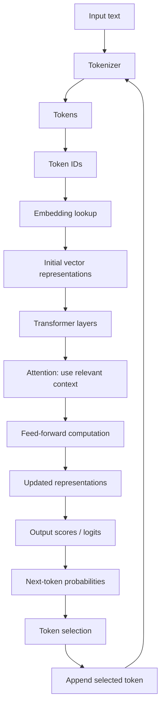
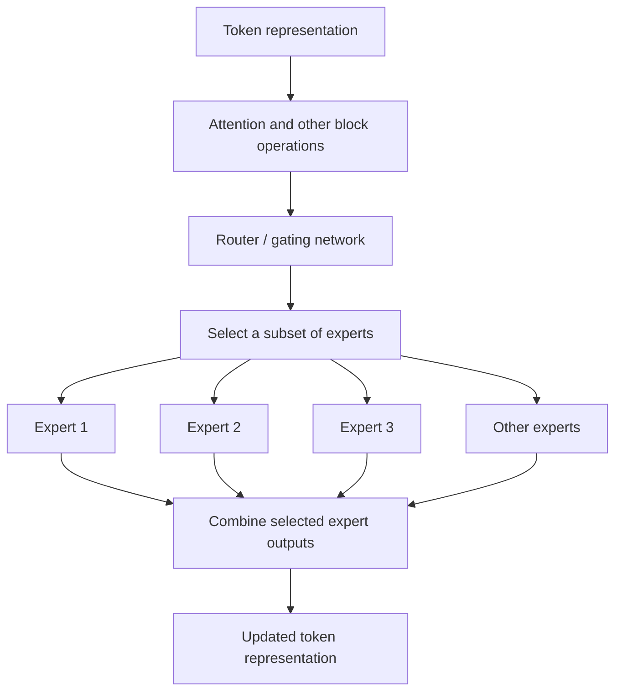
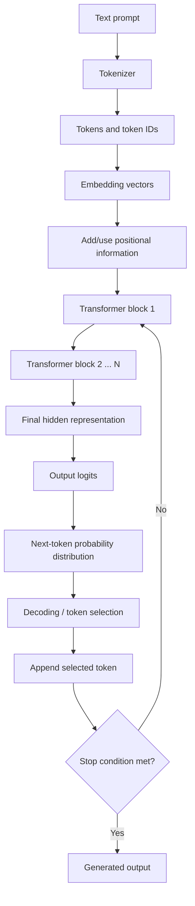

# M1.3 — Inside an LLM: Embeddings, Attention & Transformers

> **Roadmap:** CampusX AI Engineering  
> **Module ID:** M1.3  
> **Module number:** 3  
> **Difficulty:** Beginner to Intermediate  
> **Primary theme:** Tokens → Vectors → Transformer layers → Next-token probabilities  
> **Prerequisites:** M1.1 — What an LLM Actually Is; M1.2 — Tokenization  
> **Estimated study time:** 3–5 hours, including the practical exercises

---

## Table of Contents

- [1. Module Overview](#1-module-overview)
- [2. Learning Objectives](#2-learning-objectives)
- [3. The Complete Mental Model](#3-the-complete-mental-model)
- [4. From Token IDs to Embeddings](#4-from-token-ids-to-embeddings)
- [5. How Representations Change Through Transformer Layers](#5-how-representations-change-through-transformer-layers)
- [6. What Parameter Counts Mean](#6-what-parameter-counts-mean)
- [7. Why Bigger Is Not Automatically Better](#7-why-bigger-is-not-automatically-better)
- [8. Attention: The Core Intuition](#8-attention-the-core-intuition)
- [9. Queries, Keys, Values, and Attention Scores](#9-queries-keys-values-and-attention-scores)
- [10. Causal Attention](#10-causal-attention)
- [11. Dense Models](#11-dense-models)
- [12. Mixture-of-Experts Models](#12-mixture-of-experts-models)
- [13. Total Parameters vs. Active Parameters](#13-total-parameters-vs-active-parameters)
- [14. What MoE Changes in Practice](#14-what-moe-changes-in-practice)
- [15. Reading MoE Model Cards](#15-reading-moe-model-cards)
- [16. End-to-End: From Text to Next-Token Probabilities](#16-end-to-end-from-text-to-next-token-probabilities)
- [17. Practical Activity: Reason About Attention](#17-practical-activity-reason-about-attention)
- [18. Python Demonstration: Inspecting Token IDs and Embeddings](#18-python-demonstration-inspecting-token-ids-and-embeddings)
- [19. Common Misconceptions](#19-common-misconceptions)
- [20. Troubleshooting and Interpretation Tips](#20-troubleshooting-and-interpretation-tips)
- [21. Why These Concepts Matter in AI Engineering](#21-why-these-concepts-matter-in-ai-engineering)
- [22. Interview Questions and Answers](#22-interview-questions-and-answers)
- [23. Rapid Revision](#23-rapid-revision)
- [24. Exercises](#24-exercises)
- [25. Completion Checklist](#25-completion-checklist)
- [26. Key Takeaways](#26-key-takeaways)
- [27. References and Further Learning](#27-references-and-further-learning)

---

## 1. Module Overview

A Large Language Model does not process a sentence in the same way a person reads it. Before a model can work with text, the text is tokenized. Each token is represented by a token ID, and that ID is used to retrieve a learned numerical representation called an **embedding**. Transformer layers then repeatedly update these representations using mechanisms that include **attention** and feed-forward computation.

The model ultimately produces scores that can be converted into probabilities for possible next tokens. Text generation then uses a selection strategy to choose a token and continue the process.

This module explains the major ideas inside that pipeline:

- How token IDs become vectors.
- What embeddings represent conceptually.
- Why representations are updated through transformer layers.
- What model parameter counts such as 8B, 70B, and 400B+ mean.
- Why a larger model is not automatically better for every task.
- How attention helps tokens use relevant context.
- What queries, keys, values, attention scores, and causal attention mean at a high level.
- How dense models differ from Mixture-of-Experts (MoE) models.
- Why total parameters and active parameters are different.
- What MoE means for memory, computation, speed, cost, and hosting.

### The central mental model

**Text → Tokens → Token IDs → Embeddings → Transformer layers + attention → Next-token probabilities**

This is a conceptual overview rather than a complete implementation diagram. Real model architectures include additional details such as positional information, normalization, residual connections, feed-forward blocks, and output transformations.

---

## 2. Learning Objectives

By the end of this module, you should be able to:

1. Explain the difference between a token, a token ID, and an embedding.
2. Describe an embedding as a numerical vector used by the model.
3. Explain why language concepts and token representations are represented numerically.
4. Describe how a token's representation can change as it passes through transformer layers.
5. Explain what model parameters are and interpret model sizes such as 8B, 70B, and 400B+.
6. Explain why parameter count alone does not determine model quality.
7. Describe attention as a mechanism for using relevant context.
8. Explain queries, keys, values, attention scores, and causal attention without matrix mathematics.
9. Distinguish a dense model from a Mixture-of-Experts model.
10. Distinguish total parameters from active parameters in an MoE model.
11. Explain why MoE models can have high total capacity while activating only part of their parameters for a token.
12. Explain why an MoE model still needs memory for its full set of parameters, even when only a subset is used for a particular token.
13. Interpret descriptions such as `8x7B` carefully and identify what additional model-card information is needed.
14. Explain the path from an input token to next-token probabilities.

---

## 3. The Complete Mental Model

The following diagram connects the ideas in this module.



The diagram is simplified. In a real transformer, attention and feed-forward computation are typically components within each transformer block, and residual connections and normalization also contribute to the computation. The selected token is appended to the current context, and generation repeats until a stopping condition is reached.

### Keep these terms separate

| Term | Meaning |
|---|---|
| Token | A unit produced by a tokenizer; it may be a whole word, part of a word, punctuation, or another text unit. |
| Token ID | An integer identifier assigned to a token in a tokenizer's vocabulary. |
| Embedding | A learned vector associated with a token ID at the input stage. |
| Hidden representation | A vector representation inside the model that can be updated by transformer layers. |
| Parameter | A learned numerical value in the model, such as a value in an embedding table or learned layer weights. |
| Attention | A mechanism that lets a representation incorporate information from other relevant positions in the context. |
| Logit | A raw score for a possible next token before converting scores into probabilities. |
| Probability | A normalized value representing the model's estimated likelihood for a possible next token under the current context. |

---

## 4. From Token IDs to Embeddings

### 4.1 From text to token IDs

The tokenizer converts text into tokens. Each token maps to an integer ID in the tokenizer's vocabulary.

For example, the text:

```text
The cat sat.
```

might be split into tokens resembling:

```text
["The", " cat", " sat", "."]
```

The exact tokenization depends on the tokenizer. The IDs below are illustrative only; they are not the actual IDs for a particular model:

| Token (illustrative) | Token ID (illustrative) |
|---|---:|
| `The` | 101 |
| ` cat` | 482 |
| ` sat` | 913 |
| `.` | 17 |

A token ID is an identifier, not a numerical measurement of meaning. ID `913` is not inherently more meaningful, larger, or more important than ID `482`.

### 4.2 What is an embedding?

An **embedding** is a vector of learned numerical values associated with a token ID. The model uses these values as a numerical representation that can be processed by neural-network layers.

A vector is an ordered list of numbers. A tiny illustrative vector might look like this:

```text
[0.12, -0.45, 0.87, 0.03, ...]
```

Real embedding vectors can have hundreds or thousands of dimensions, depending on the model architecture. The numbers are learned during training; they are not manually assigned labels such as “animal = 1” or “happy = 2.”

An embedding is not a human-readable definition. Its dimensions generally do not correspond to simple, individually named concepts. Meaning is represented in distributed patterns across dimensions and learned interactions.

### 4.3 Why convert tokens into vectors?

Neural networks operate on numerical values. Raw words and characters cannot be directly processed by the matrix operations used in a transformer. Token IDs provide discrete identifiers, and embeddings turn those identifiers into vectors that the model can process.

The basic path is:

1. The tokenizer splits text into tokens.
2. Each token is mapped to a token ID.
3. The token ID selects a row from a learned embedding table.
4. That row supplies the initial vector representation for the token.
5. The model processes these vectors through transformer layers.

### 4.4 Embedding table: a lookup analogy

Think of the embedding table as a large learned lookup table:

| Token ID | Learned vector |
|---:|---|
| 101 | `[0.12, -0.45, 0.87, ...]` |
| 482 | `[-0.20, 0.31, 0.14, ...]` |
| 913 | `[0.54, 0.02, -0.38, ...]` |

These vectors are only illustrative. The table is part of the model's learned parameters. The token ID selects a vector; the ID itself is not transformed into meaning by its integer magnitude.

### 4.5 Why are representations numerical?

Numerical representations allow the model to learn statistical patterns from training data. During training, the model adjusts its parameters so that the representations and subsequent computations help it predict tokens.

Vectors make it possible to use learned operations to represent similarities, differences, context, and relationships. However, it is too simplistic to say that one dimension always corresponds to one concept or that an embedding is a complete dictionary definition.

### 4.6 Token embeddings versus contextual representations

An important distinction:

- **Input token embedding:** the learned vector looked up for a token ID at the input stage.
- **Contextual hidden representation:** the vector after processing by transformer layers, influenced by the surrounding context.

The same token can have different contextual representations in different sentences.

Consider the word “bank”:

- “She deposited money at the bank.”
- “They sat on the river bank.”

The tokenizer may use the same token ID for `bank` in both examples, depending on the tokenizer. But attention and other layer computations can make the internal representation of `bank` differ because the surrounding context differs.

This does not mean that the model looks up a separate permanent embedding for every meaning of `bank`. Instead, the initial token representation is processed and updated in context.

### 4.7 Position also matters

A sequence is not just a bag of token vectors. The model needs information about token positions or order. Transformer architectures use positional information in architecture-specific ways, such as positional embeddings or rotary position methods.

For example:

- `The dog chased the cat.`
- `The cat chased the dog.`

The same words appear, but their order changes the meaning. A transformer needs a way to account for positions and sequence order. The exact mechanism varies by model architecture.

### 4.8 Summary: token IDs to embeddings

| Stage | What happens | What it does not mean |
|---|---|---|
| Text | The original input is supplied. | The model does not directly process text as a human reader does. |
| Tokenization | Text is split into tokenizer units. | A token is not always a complete word. |
| Token ID | Each token maps to a vocabulary identifier. | The integer's size does not indicate semantic importance. |
| Embedding lookup | The ID selects a learned vector. | The vector is not a dictionary definition. |
| Transformer processing | Context-sensitive computation updates representations. | The initial embedding alone does not fully capture the token's meaning in every sentence. |

---

## 5. How Representations Change Through Transformer Layers

### 5.1 Why are multiple layers needed?

The initial embedding gives the model a learned starting representation for each token. Transformer layers repeatedly process these representations so they can incorporate contextual information and support increasingly useful computations.

At a high level, a transformer layer contains attention and feed-forward computation, along with supporting operations such as normalization and residual connections. Exact details vary by architecture.

A simplified view:

```text
Initial token representations
          ↓
Transformer layer 1
          ↓
Updated representations
          ↓
Transformer layer 2
          ↓
Further updated representations
          ↓
More transformer layers
          ↓
Contextual representations used for prediction
```

### 5.2 What does “updated representation” mean?

It means the vector values change as the model processes the input. Information from other token positions can influence a token's representation through attention. Feed-forward computation then transforms the representation further.

The model is not necessarily storing a single explicit sentence definition. Instead, its internal numerical representations are repeatedly transformed to support the prediction task learned during training.

### 5.3 Context changes representation

Consider:

> The animal didn't cross the street because it was tired.

The token `it` is interpreted in the context of the surrounding words. A useful representation should reflect the relationship between `it` and the likely referent `the animal`, rather than treating `it` as an isolated token.

Now compare:

> The animal didn't cross the street because it was busy.

The context differs, so the internal representations can differ. The model uses patterns learned during training to estimate which relationships are likely.

This example is useful for reasoning about context; it should not be taken as a guarantee that every model or every attention head will assign a simple, human-interpretable pattern to the word `it`.

### 5.4 Residual connections and normalization: high-level awareness

Many transformer architectures use residual connections and normalization around sublayers.

- **Residual connections** provide paths for existing representations to be carried forward while layer computations contribute updates.
- **Normalization** helps control the scale and behavior of activations during model computation.

You do not need the implementation details to understand this module. The key point is that a transformer layer does more than replace each token with a dictionary entry: it repeatedly transforms representations.

### 5.5 Why this matters

This explains how a model can use the same token in different contexts, relate distant parts of a prompt, and build representations useful for predicting the next token.

---

## 6. What Parameter Counts Mean

### 6.1 What is a model parameter?

A **parameter** is a learned numerical value in a model. Parameters are adjusted during training to improve the model's performance on its training objective.

Parameters include learned values in components such as embedding tables, attention projections, feed-forward networks, and other learned layers. The exact parameter distribution depends on the architecture.

### 6.2 What do 8B, 70B, and 400B+ mean?

The suffix `B` means **billion**.

| Label | Approximate parameter count |
|---|---:|
| 8B | 8 billion parameters |
| 70B | 70 billion parameters |
| 400B+ | More than approximately 400 billion parameters |

A model label such as `70B` usually refers to the model's total parameter count, but for MoE models it is important to check whether the description refers to total parameters, active parameters, or another convention.

### 6.3 Parameters are not the same as training examples

A model with 70 billion parameters does not mean it has memorized exactly 70 billion facts, words, or documents. Parameter count is a measure of learned numerical values, not a direct count of facts or training examples.

### 6.4 Parameters are not tokens

Keep these concepts distinct:

| Concept | What it counts |
|---|---|
| Parameters | Learned numerical values in the model. |
| Training tokens | Token units processed during training, according to the training setup's counting convention. |
| Input tokens | Tokens supplied in a particular request or prompt. |
| Output tokens | Tokens generated by the model in a response. |
| Context window | The maximum context the model can process under the model's specified limits and configuration. |

### 6.5 Why parameter count matters

Parameter count can affect:

- The amount of model capacity available to learn patterns.
- The memory required to store model weights.
- The compute and infrastructure required to serve the model.
- Latency and throughput, depending on architecture, hardware, quantization, batching, and implementation.
- Hosting and deployment choices.

Parameter count alone is not enough to predict the exact memory footprint, runtime cost, or performance. Weight precision, architecture, runtime overhead, and serving configuration also matter.

### 6.6 A rough weight-memory illustration

A rough lower-bound-style estimate for weight storage is:

\[
\text{Weight memory in bytes} \approx
\text{Number of parameters} \times \text{Bytes per parameter}
\]

For example, if weights are stored using 2 bytes per parameter, then 8 billion parameters require approximately 16 billion bytes for the weights alone. This excludes additional memory for activations, caches, runtime overhead, and other implementation details. Actual memory requirements depend on the storage format and serving setup.

Use this estimate only as a starting point, not as a complete GPU-memory calculator.

---

## 7. Why Bigger Is Not Automatically Better

More parameters can increase a model's capacity, but **parameter count alone does not determine quality**.

### 7.1 What can a larger model offer?

A larger model may have more capacity to learn complex patterns and relationships, depending on how it is trained and used. In a well-designed training setup, increased capacity can contribute to better performance on some tasks.

### 7.2 Why might a smaller model be preferable?

A smaller model can be a better practical choice when it meets the required quality level while offering lower latency, cost, memory use, or deployment complexity.

### 7.3 What else affects model quality?

Model performance depends on multiple factors, including:

- Training-data quality and coverage.
- Training compute and training procedure.
- Model architecture.
- Tokenizer and context handling.
- Fine-tuning or post-training methods.
- Evaluation methodology and task fit.
- Inference settings and system design.
- Quantization or other deployment trade-offs.

The relative importance of these factors depends on the model and use case.

### 7.4 Practical comparison

| Consideration | Larger model | Smaller model |
|---|---|---|
| Capacity | Often has more parameter capacity. | Has less parameter capacity, but may still be sufficient. |
| Memory | Usually requires more weight storage at the same precision. | Usually requires less weight storage at the same precision. |
| Latency | May be higher, but actual results depend on architecture and infrastructure. | May be lower, but benchmarking is still necessary. |
| Cost | Can cost more to host or serve. | Can be cheaper to serve. |
| Task quality | May perform better on some tasks, but not automatically. | May perform well on targeted tasks, especially with suitable training and setup. |
| Deployment | May require more powerful or distributed infrastructure. | May be easier to run locally or on limited hardware. |

### 7.5 The engineering rule

Do not select a model based only on the largest parameter number. Evaluate the model on the target task, quality requirements, latency budget, cost, privacy needs, context requirements, and available infrastructure.

---

## 8. Attention: The Core Intuition

### 8.1 What is attention?

**Attention lets a token's representation use information from other token positions in the available context.**

A useful intuition is:

> A token looks at other relevant tokens in the context to build a better representation of what it means.

This is a conceptual explanation. The actual mechanism uses learned numerical operations rather than human-like conscious attention.

### 8.2 Why is attention useful?

Language often depends on relationships across a sentence or a longer passage.

Examples:

- Pronouns may refer to nouns mentioned earlier.
- A verb may depend on the subject.
- A word's meaning may depend on nearby or distant context.
- A question may require information from an earlier sentence.
- Code may refer to a variable or function defined earlier.

Attention gives the model a mechanism for combining information across positions in the sequence.

### 8.3 Example: resolving a pronoun

Sentence:

> The animal didn't cross the street because it was tired.

When processing `it`, context containing `the animal`, `cross`, `street`, and `tired` can all be relevant. The likely interpretation is that the animal was tired.

Do not assume that attention must look only at the nearest word. Useful information can be located earlier in the sequence. Also, the interpretation of a sentence can depend on broader context and world knowledge, not just one attention link.

### 8.4 Attention is not a fixed dictionary lookup

The embedding lookup gives a starting vector. Attention contributes contextual information based on the current sequence and the model's learned parameters. This is one reason the same token can be represented differently in different contexts.

### 8.5 Attention is not necessarily a human-readable explanation

Attention weights can sometimes be visualized, but they should not automatically be treated as a complete explanation of why the model produced an answer. A model has many layers, heads, and interacting computations. An attention visualization is useful evidence about one part of the computation, not a guaranteed explanation of the whole model.

---

## 9. Queries, Keys, Values, and Attention Scores

You should understand the purpose of queries, keys, and values at a high level before learning their matrix equations.

### 9.1 The intuition

For each token representation, an attention mechanism produces three learned representations:

- **Query (Q):** what this token is looking for from other positions.
- **Key (K):** what a token position makes available for matching.
- **Value (V):** the information that can be contributed if that position is attended to.

These are analogies to help build intuition. Queries, keys, and values are learned vector representations, not literal questions, labels, or database records.

### 9.2 How attention works conceptually

A simplified conceptual sequence:

1. The model creates query, key, and value representations from token representations.
2. It compares a token's query with keys at positions it is allowed to consider.
3. Those comparisons produce attention scores.
4. The scores are converted into weights that determine how much information to take from each allowed position.
5. The model combines value information using those weights.
6. The result contributes to an updated representation.

### 9.3 An analogy

Imagine each token has:

- A query that represents what information would be useful.
- A key that represents what kind of information it may match.
- A value that represents the information it can contribute.

A query that matches a key more strongly can receive a larger attention weight, subject to the model's attention computation and masking rules.

The analogy is not exact: real attention is numerical, learned, and computed over vectors.

### 9.4 Attention scores and weights

An **attention score** reflects how strongly a query matches a key under the attention calculation. The scores are typically normalized into weights, often using softmax, so the model can combine value vectors.

At a conceptual level:

- Higher relative score can mean a position receives more weight.
- Lower relative score can mean a position receives less weight.
- Masking can prevent certain positions from being considered.
- The final combination of values contributes to the updated token representation.

Exact implementations vary. You do not need to memorize the matrix operations for this module.

### 9.5 What is a transformer layer?

A transformer layer (or block) is a repeated processing unit in a transformer architecture. It commonly includes attention and a feed-forward network, along with supporting operations such as residual connections and normalization.

The attention component mixes information across token positions. The feed-forward component transforms representations, typically position by position within the block. Repeating these layers allows the model to construct richer representations.

### 9.6 What are attention heads?

Many transformer layers use **multi-head attention**. Rather than relying on a single attention operation, the layer computes multiple attention heads. Each head can learn different patterns of relationships, although those patterns are not guaranteed to map neatly to human-readable categories.

A useful high-level view:

- One head may become sensitive to one kind of relationship.
- Another head may respond to a different pattern.
- The model combines their outputs to update the representations.

Avoid assuming that each head has one fixed, interpretable purpose.

### 9.7 Summary table

| Term | High-level meaning |
|---|---|
| Query | Representation used to determine what information a token seeks from other positions. |
| Key | Representation compared with queries to determine relevance. |
| Value | Representation carrying information that can be combined into the output. |
| Attention score | Numerical compatibility score between a query and a key. |
| Attention weight | Normalized weight used to combine information from allowed positions. |
| Attention head | One of multiple attention computations within multi-head attention. |
| Transformer layer | A block that commonly combines attention and feed-forward computation with supporting operations. |

---

## 10. Causal Attention

### 10.1 What does “causal” mean?

In a standard decoder-only language model used for autoregressive generation, **causal attention** prevents a token position from using information from future token positions.

When predicting the next token, the model can use the tokens that are already available in the context, but it must not use the actual future token it is supposed to predict.

### 10.2 Why is causal attention needed?

The training objective teaches an autoregressive model to predict tokens from preceding context. If a position could directly access the future target token during training, it could use information that would not be available during ordinary generation.

Causal masking enforces the appropriate direction of information flow.

### 10.3 Example

For the sequence:

```text
The cat sat
```

When processing the position corresponding to `cat`, a causal mask prevents that position from attending to the later token `sat`.

A simplified visibility table:

| Current position | May use | Must not use |
|---|---|---|
| `The` | `The` | `cat`, `sat` |
| `cat` | `The`, `cat` | `sat` |
| `sat` | `The`, `cat`, `sat` | Tokens that come after `sat` in the sequence |

The exact indexing and whether a model predicts from a position before or after a token depends on implementation details, but the core rule is that a prediction cannot use future target tokens.

### 10.4 Causal attention versus ordinary language use

Causal attention does not mean a model can never consider the full prompt. Once a prompt has been supplied, every token in that prompt is already available as context for generating the next token. The causal rule concerns which positions each token position can use during the model's computation.

### 10.5 Scope note

This module focuses on autoregressive, decoder-only LLMs. Other transformer designs, such as encoder models or encoder-decoder systems, can use different attention masks and information-flow patterns.

---

## 11. Dense Models

### 11.1 What is a dense model?

In a conventional **dense transformer**, the relevant model layers use their full set of layer parameters for each token's forward pass. In a dense feed-forward layer, the layer's feed-forward parameters are used for each token processed by that layer.

This is the contrast commonly made with MoE feed-forward layers, where routing selects only a subset of experts for a token.

### 11.2 Dense model: conceptual flow

```text
Token representation
        ↓
Attention computation
        ↓
Dense feed-forward layer
        ↓
Updated representation
```

The diagram is simplified and represents a block-level intuition, not every operation in a full model.

### 11.3 What does “every parameter takes part” mean?

For the purpose of this roadmap, a dense model is described as one where the model's dense layer parameters participate in processing each token. This contrasts with MoE models, where only selected expert feed-forward parameters are active for a particular token.

Strictly speaking, architecture components can differ in how they are used, and not every parameter in an entire model is necessarily used in precisely the same operation at every point. The key distinction here is **dense computation versus conditional expert routing**.

### 11.4 Advantages and trade-offs

| Consideration | Dense model |
|---|---|
| Computation pattern | Generally more uniform: the same dense layers are applied to each token. |
| Parameter use | Dense layer parameters participate in each token's computation through those layers. |
| Serving behavior | Often simpler to reason about than expert routing, although serving cost still depends on architecture and implementation. |
| Memory | Weight memory depends on total parameter count and weight format. |
| Scaling | Increasing model size typically increases weight storage and computation, all else being equal. |

---

## 12. Mixture-of-Experts Models

### 12.1 What is a Mixture-of-Experts (MoE) model?

A **Mixture-of-Experts (MoE)** model divides parts of its feed-forward computation into multiple expert networks. A learned routing mechanism selects a subset of experts for each token.

Instead of sending every token through every expert, the router directs each token to only some of the experts.

### 12.2 The main components

- **Experts:** separate feed-forward networks that can learn different transformations.
- **Router or gating network:** computes which experts should process a token.
- **Routing decision:** selects the expert or experts used for that token.
- **Combination:** outputs from selected experts are combined according to the architecture.

These are high-level descriptions. The number of experts, routing strategy, selection count, and output combination vary across MoE designs.

### 12.3 MoE: conceptual flow



The diagram shows several possible experts, but a particular token generally uses only the subset selected by the router. It does not imply that all experts are active for every token.

### 12.4 Why use experts?

MoE architectures are designed to increase total model capacity while keeping the amount of expert computation used for each token lower than if every expert were activated. This can make it possible to scale the total parameter count without proportionally activating all those expert parameters for every token.

The actual quality, speed, and cost benefits depend on architecture, hardware, routing, communication overhead, and serving implementation.

### 12.5 A simple analogy

Imagine a team with specialists:

- One specialist is selected for one kind of problem.
- Another specialist is selected for a different kind of problem.
- A coordinator routes each request to a small number of specialists.

The analogy helps explain routing, but neural-network experts are not manually defined human job roles. Their behavior is learned through training, and their specialization may be distributed or difficult to interpret.

### 12.6 Dense versus MoE

| Feature | Dense model | MoE model |
|---|---|---|
| Feed-forward structure | Dense feed-forward network(s). | Multiple expert feed-forward networks plus routing. |
| Per-token expert computation | Uses the dense feed-forward parameters in the relevant layers. | Uses only the selected expert subset in MoE layers. |
| Total parameter count | All model parameters contribute to the model's total size. | Includes parameters across the experts, including experts not selected for a particular token. |
| Active parameters | Often close to the model's parameter count for the relevant dense computation, subject to architecture details. | Can be much smaller than total parameters for a given token. |
| Weight memory | Depends on total parameters and precision. | Must account for the expert weights the deployment needs to keep available, as well as other model weights. |
| Runtime complexity | Often simpler routing behavior. | Adds routing and may add expert-dispatch or communication overhead. |

---

## 13. Total Parameters vs. Active Parameters

### 13.1 Total parameters

**Total parameters** means the number of learned parameter values in the model as a whole, including all expert networks in an MoE model.

### 13.2 Active parameters

**Active parameters** refers to the parameters used for a particular token's forward computation, under the convention used by a model's documentation. For an MoE model, this typically includes the shared components and the selected experts, rather than every expert in the model.

Model cards may use different conventions for reporting active parameters. Always read the model's own definition and technical documentation.

### 13.3 Why can total and active parameters differ so much?

Suppose an MoE model has many experts, but the router selects only a few experts for each token. The model can have a very large total parameter count while using only a subset of expert parameters for a token's computation.

This is the central MoE trade-off:

- **Total parameters** indicate the overall learned parameter capacity and weight storage that may need to be available.
- **Active parameters** help describe how much of the model is involved in processing a particular token.
- Active parameters are not the same thing as total memory required to host the model.

### 13.4 Illustrative example

Imagine a hypothetical model with 8 experts. Each expert contains 7 billion parameters, giving 56 billion expert parameters in total. Suppose the router selects 2 experts for a token.

For the expert component only:

| Quantity | Illustrative value |
|---|---:|
| Number of experts | 8 |
| Parameters per expert | 7B |
| Total expert parameters | 56B |
| Experts selected for a token | 2 |
| Selected expert parameters for that token | 14B |

This illustration excludes shared attention layers, embeddings, routing parameters, and other components. It is not a claim about the exact architecture or active-parameter count of a real `8x7B` model.

### 13.5 What this example teaches

Even though only 2 of the 8 experts are selected for this token, the full set of expert weights may still need to be stored in GPU memory, distributed across GPUs, or otherwise available to the serving system. Selecting fewer experts reduces the expert computation per token compared with activating all experts, but it does not automatically eliminate the memory requirement for the unselected experts.

### 13.6 Active parameters are not a complete speed or cost metric

A lower active-parameter count can suggest lower per-token computation than a dense model with a similar total parameter count, but it does not guarantee lower end-to-end latency or cost. Routing, communication between devices, batch size, memory bandwidth, cache behavior, and infrastructure can change the result.

---

## 14. What MoE Changes in Practice

### 14.1 Compute and memory are different constraints

This distinction is central to understanding MoE.

- **Compute per token:** only the selected experts are used for a token in an MoE layer, so expert computation can be closer to that of a smaller model than to a dense model with the same total parameter count.
- **Weight memory:** the serving system still needs access to the weights for all experts that may be selected. Depending on the deployment, those weights may be stored across multiple GPUs or other devices.
- **Communication:** routing tokens to experts can create additional data movement, especially in distributed deployments.
- **Latency and throughput:** the final result depends on routing efficiency, batching, hardware, implementation, and workload.

### 14.2 A practical comparison

| Deployment question | Why it matters for MoE |
|---|---|
| How many total parameters are there? | Helps estimate the scale of the model's full weight storage. |
| How many active parameters are used per token? | Helps estimate the selected computation, but is not a complete runtime estimate. |
| How many experts are selected per token? | Affects the expert computation and routing behavior. |
| What precision or quantization is used? | Changes the weight-memory footprint and may affect quality or speed. |
| How many devices are required? | Large expert weights may need to be distributed across devices. |
| What is the inter-device communication cost? | Expert dispatch and output combination can introduce overhead. |
| What is the workload? | Batch size, context length, throughput targets, and concurrency affect serving performance. |

### 14.3 Why a large MoE model may cost less to compute per token than a similarly sized dense model

If the MoE router activates only a fraction of the expert parameters for each token, the model avoids running every expert for every token. Therefore, expert computation can be substantially lower than it would be if all expert parameters were used for every token.

However, **lower active computation does not mean the full model is small to host**. A large MoE model may still require substantial memory, multiple accelerators, or a specialized serving stack.

### 14.4 Practical takeaway

When evaluating an MoE model, do not look only at its total parameter count or only at its active parameter count. Consider both, together with memory precision, context length, hardware, routing overhead, and measured latency.

---

## 15. Reading MoE Model Cards

### 15.1 What is a model card?

A model card is documentation describing a model, often including its intended use, architecture, training, limitations, evaluation, and deployment-related details. For this module, focus on architecture labels and parameter-count descriptions.

### 15.2 What might `8x7B` mean?

A label such as `8x7B` is often used to communicate an MoE model built from eight experts with roughly 7 billion parameters per expert. However, naming conventions are not universal, and the label alone may not describe the entire architecture.

It may omit or leave unclear:

- Shared parameters outside the experts.
- Whether the count includes all model components.
- How many experts are selected for each token.
- The exact active-parameter count.
- The parameter precision required for deployment.
- The model's context window or serving requirements.

**Do not infer an exact total or active parameter count from a name alone.** Confirm the architecture and counting convention in the model card or technical report.

### 15.3 A checklist for reading model cards

When you encounter a model described as `8x7B`, `total parameters`, or `active parameters`, look for:

1. **Architecture type:** dense, MoE, or another architecture.
2. **Total parameters:** the full model parameter count and what is included.
3. **Active parameters:** the number used per token and the definition used.
4. **Expert count:** how many experts exist in the MoE layers.
5. **Routing policy:** how many experts are selected per token, if documented.
6. **Shared components:** whether embeddings, attention, router, or other components are counted separately.
7. **Weight format:** precision or quantization used for reported memory estimates.
8. **Memory requirements:** recommended GPU or multi-device configuration.
9. **Inference performance:** latency, throughput, and evaluation conditions.
10. **Licensing and use restrictions:** whether the intended application is permitted.

### 15.4 How to interpret the label

| Model-card information | What you can infer | What you should not infer automatically |
|---|---|---|
| `70B` | The model is described as having approximately 70 billion parameters, subject to its counting convention. | That it is always better than every smaller model. |
| `8x7B` | The name likely communicates a relationship between eight expert-sized components and a 7B scale. | That the complete model has exactly 56B parameters or that exactly 14B parameters are active. |
| `Total parameters: ...` | The documented total model size under the author's convention. | The exact amount of compute for each token. |
| `Active parameters: ...` | A documented estimate of parameters used per token or forward pass under the model's convention. | The full memory needed to host the model. |
| Quantized weights | The model uses a reduced-precision representation for weights. | That memory, speed, and quality will change by one universal fixed ratio. |

### 15.5 Deployment decision rule

Use the model card to identify total and active parameters, then verify the expected memory footprint and benchmark the actual serving setup. Do not make hosting decisions based only on the model's marketing name.

---

## 16. End-to-End: From Text to Next-Token Probabilities

This section connects the full module.

### Step 1: Text enters the tokenizer

The input text is split into tokens according to the tokenizer's vocabulary and rules.

### Step 2: Tokens become token IDs

Each token is mapped to an integer identifier. These identifiers are used to retrieve learned representations.

### Step 3: Token IDs become embedding vectors

The embedding table maps each token ID to a learned vector. Positional information is also incorporated according to the architecture.

### Step 4: Representations pass through transformer layers

Each layer updates the representations. Attention enables information to be combined across allowed positions, and feed-forward computation transforms representations further. Residual connections and normalization commonly support this process.

### Step 5: Causal attention respects the generation order

For a decoder-only autoregressive LLM, causal masking prevents a token position from using future target tokens. The model predicts using the context available at that point.

### Step 6: The final representation is transformed into output scores

For next-token prediction, the model produces a set of logits—raw scores associated with possible next tokens in its vocabulary.

### Step 7: Scores become probabilities

A normalization step, commonly softmax, can convert logits into a probability distribution over possible next tokens. The probability distribution represents the model's next-token estimates under the current context and configuration.

### Step 8: A token is selected

A decoding strategy selects the next token. Depending on the generation configuration, this can involve greedy selection, sampling, temperature, top-k, top-p, or other controls.

### Step 9: Generation repeats

The selected token is appended to the context, and the model computes the next token. This repeats until a stopping condition is reached, such as an end-of-sequence token or a generation limit.

### Complete flow



This diagram is conceptual. Exact ordering and implementation details vary across architectures, and production systems may use a key-value cache to avoid recomputing all prior states during generation.

---

## 17. Practical Activity: Reason About Attention

### Activity objective

Inspect a sentence and reason about which earlier words may be relevant to a token's interpretation. The purpose is to develop an intuition for contextual representations, not to prove that a specific attention head has a human-readable meaning.

### Sentence

> The animal didn't cross the street because it was tired.

Focus token: `it`

### Questions

1. Which earlier token or phrase is the most plausible referent for `it`?
2. Which other words provide useful context for interpreting the sentence?
3. Would the likely interpretation change if the sentence were “The animal didn't cross the street because it was blocked”?
4. Why might the representation of `it` differ across the two sentences?
5. Why should you avoid treating one attention visualization as a complete explanation of the model's reasoning?

### Suggested reasoning

- `the animal` is the most plausible referent for `it` in the original sentence.
- `tired`, `cross`, and `street` contribute contextual information.
- Changing the reason clause can alter the relationships that are useful for interpretation.
- Transformer layers update representations using context, so the contextual representation can differ between sentences.
- Attention is one component of a larger computation; a visualization shows only part of the mechanism.

### Optional extension

Use an attention visualization tool that explicitly supports the model you are studying. Check its tokenizer, layer, head, and visualization settings. Treat the visualization as a way to explore patterns, not as a universal explanation of the model's answer.

---

## 18. Python Demonstration: Inspecting Token IDs and Embeddings

This optional demonstration shows the difference between tokenization and embedding lookup using a small Hugging Face model. It is not necessary to run the code to understand the conceptual module.

### 18.1 Install dependencies

```bash
pip install transformers torch
```

### 18.2 Inspect tokens and token IDs

```python
from transformers import AutoTokenizer

model_name = "bert-base-uncased"

tokenizer = AutoTokenizer.from_pretrained(model_name)

text = "The animal didn't cross the street because it was tired."

tokens = tokenizer.tokenize(text)
token_ids = tokenizer.convert_tokens_to_ids(tokens)

print("Text:", text)
print("Tokens:", tokens)
print("Token IDs:", token_ids)
```

**What this demonstrates:**

- The tokenizer splits the input into model-specific tokens.
- Each token has an integer ID.
- Tokenization and token IDs depend on the tokenizer and model vocabulary.
- These IDs are identifiers; they are not direct measures of meaning.

The example uses a BERT tokenizer for a simple demonstration. BERT is not a decoder-only generative LLM, so do not use this example to demonstrate autoregressive causal generation.

### 18.3 Inspect embedding vectors

```python
import torch
from transformers import AutoModel, AutoTokenizer

model_name = "bert-base-uncased"

tokenizer = AutoTokenizer.from_pretrained(model_name)
model = AutoModel.from_pretrained(model_name)

text = "The animal didn't cross the street because it was tired."
inputs = tokenizer(text, return_tensors="pt")

with torch.no_grad():
    outputs = model(**inputs)

# The model's input embedding table
input_embeddings = model.get_input_embeddings()

# Shape: (batch_size, sequence_length, embedding_dimension)
initial_vectors = input_embeddings(inputs["input_ids"])

print("Input IDs shape:", inputs["input_ids"].shape)
print("Initial embedding shape:", initial_vectors.shape)
print("Contextual output shape:", outputs.last_hidden_state.shape)
```

**How to interpret the shapes:**

- `inputs["input_ids"]` contains the token IDs.
- `initial_vectors` contains the initial embedding vectors retrieved for those IDs.
- `outputs.last_hidden_state` contains contextual representations produced after the model processes the input.
- The final dimension is the representation size for this particular model.

The exact dimensions depend on the chosen model. This code does not prove that an individual vector dimension corresponds to a specific human concept.

### 18.4 Compare the same token in different contexts

```python
sentences = [
    "She deposited money at the bank.",
    "They sat on the river bank."
]

for sentence in sentences:
    inputs = tokenizer(sentence, return_tensors="pt")

    with torch.no_grad():
        outputs = model(**inputs)

    tokens = tokenizer.convert_ids_to_tokens(inputs["input_ids"][0])

    print("\nSentence:", sentence)
    print("Tokens:", tokens)
    print("Contextual output shape:", outputs.last_hidden_state.shape)
```

This prints the token sequence and output shape for each sentence. To compare the actual contextual vectors for `bank`, you would locate the relevant token position in each tokenized sentence and compare the corresponding hidden-state vectors. For a beginner exercise, focus first on understanding the distinction between the initial embedding lookup and the contextual output.

### 18.5 Important limitations

- The model is a demonstration model, not a benchmark of all LLM architectures.
- BERT uses bidirectional attention rather than the standard causal masking used in decoder-only autoregressive LLMs.
- A contextual representation is a learned numerical state, not a directly readable explanation.
- Downloading model files may require an internet connection and local storage.
- In production, model selection and inference should account for licensing, hardware, privacy, and deployment requirements.

---

## 19. Common Misconceptions

| Misconception | Correct understanding |
|---|---|
| A token ID is a numerical representation of meaning. | It is an integer identifier used to look up a learned representation. |
| An embedding is a dictionary definition. | It is a learned vector; meaning is represented through distributed numerical patterns and contextual processing. |
| Every embedding dimension corresponds to one concept. | Dimensions are generally not individually interpretable in such a simple way. |
| A token's input embedding fully captures its meaning in every sentence. | Transformer layers produce contextual representations that depend on surrounding tokens. |
| Attention means the model consciously focuses like a human. | Attention is a learned numerical mechanism for combining information across positions. |
| The word receiving the largest attention weight is always the explanation for an answer. | Attention visualizations are partial views of a larger computation. |
| Queries, keys, and values are literal questions, labels, and stored answers. | They are learned vector representations used in the attention calculation. |
| Causal attention means the model cannot use the full prompt. | It can use all prompt tokens that are already available when generating the next token; the mask prevents access to future target tokens at earlier positions. |
| 70B means 70 billion facts. | It means approximately 70 billion parameters under the model's counting convention. |
| A model with more parameters is always better. | Quality depends on data, training, architecture, task fit, and evaluation. |
| An MoE model uses every expert for every token. | The router selects only a subset of experts for each token in MoE layers. |
| Active parameters tell you how much memory is needed to host an MoE model. | Active parameters describe computation under a stated convention; memory must account for weights that may be selected, including inactive experts. |
| Fewer active parameters guarantee lower latency. | Routing, communication, memory bandwidth, hardware, and workload affect latency. |
| `8x7B` always means exactly 56B total parameters. | Naming conventions vary; verify total and active counts in the model card. |

---

## 20. Troubleshooting and Interpretation Tips

### 20.1 “The same word has the same embedding, so how can its meaning change?”

The initial token embedding can be the same when the tokenizer maps the word to the same token ID. Transformer layers then update its representation using context, so the contextual hidden representation can differ.

### 20.2 “Does every attention head represent one specific relationship?”

No. Heads can learn different patterns, but their behavior is not guaranteed to map to one stable, human-readable role. Interpret visualizations carefully.

### 20.3 “Does a 70B model always require exactly a certain amount of GPU memory?”

No. Weight memory depends on parameter count and weight format, while total runtime memory also depends on context length, batch size, caches, activations, implementation, and serving overhead. Use estimates as starting points and verify the model's documented requirements.

### 20.4 “If an MoE model activates only a few experts, can I store only those experts?”

Not necessarily. The router can select different experts for different tokens. A serving system usually needs access to the weights of every expert that may be selected. A deployment may distribute or offload weights, but that introduces additional systems considerations.

### 20.5 “Does an MoE model always run faster than a dense model with the same total parameter count?”

No. Lower expert computation per token can help, but routing and communication overhead may reduce or erase the advantage in some configurations. Benchmark the actual model and serving setup.

### 20.6 “Can I calculate quality from parameter count?”

No. Parameter count alone cannot predict task quality. Use relevant evaluations and test the model on representative tasks.

---

## 21. Why These Concepts Matter in AI Engineering

Understanding the internals of an LLM helps with practical engineering decisions.

| Engineering task | Why this module matters |
|---|---|
| Model selection | Parameter count is one factor in balancing quality, memory, latency, and cost. |
| Local deployment | Weight storage and active computation help estimate hardware requirements. |
| Cloud inference | Total and active parameters, precision, and serving design affect deployment choices. |
| RAG systems | Token representations and context processing help explain how prompts and retrieved text are processed. |
| Context-window planning | The model processes token sequences, and attention computation depends on the architecture and sequence length. |
| Latency optimization | Model size, attention implementation, batching, caching, and routing can affect response time. |
| Model-card evaluation | Knowing dense versus MoE terminology helps interpret model architecture descriptions. |
| Debugging model behavior | Contextual representations and attention offer a conceptual framework for why surrounding text matters. |
| Cost estimation | Parameter count helps reason about hosting; actual API costs depend on provider pricing and usage. |
| Responsible evaluation | A larger model or an attention visualization should not be treated as a guarantee of correctness or interpretability. |

### Practical model-selection checklist

Before choosing a model for an application, ask:

- Does it perform well on my actual task?
- What are its total parameters?
- If it is MoE, what are its active parameters and routing details?
- What precision or quantization is available?
- How much memory does the intended serving configuration need?
- What latency and throughput does it achieve on the target hardware?
- What context length is supported?
- What are the cost, license, privacy, and operational requirements?
- Have I evaluated its failure cases?

---

## 22. Interview Questions and Answers

### Q1. What is an embedding in an LLM?

An embedding is a learned numerical vector associated with a token ID. It provides a representation that neural-network layers can process. Transformer layers then update representations using context.

### Q2. What is the difference between a token ID and an embedding?

A token ID is an integer identifier from a tokenizer's vocabulary. An embedding is a learned vector retrieved using that ID.

### Q3. Why do LLMs use vectors?

Neural networks perform numerical computations. Vectors let the model learn and transform representations of tokens and their relationships.

### Q4. Does an embedding directly store the meaning of a word?

Not as a human-readable definition. It is a learned vector whose useful patterns are distributed across dimensions and shaped by training.

### Q5. Why can the same word have different meanings in different sentences?

The initial embedding may be the same, but transformer layers update its representation based on surrounding context. This lets the model represent contextual differences.

### Q6. What are model parameters?

Parameters are learned numerical values adjusted during training. They include weights in components such as embedding tables, attention projections, and feed-forward networks.

### Q7. What does 8B mean?

It usually means approximately eight billion parameters, according to the model's counting convention. For MoE models, verify whether a stated count is total or active.

### Q8. Does a model with more parameters always perform better?

No. Quality also depends on training data, architecture, training methods, evaluation, and task fit. A larger model may also require more memory and cost more to serve.

### Q9. What is attention?

Attention is a learned mechanism that allows a token's representation to incorporate information from other token positions in the available context.

### Q10. What are queries, keys, and values?

Queries represent what information a position seeks, keys are compared with queries to calculate relevance, and values carry information that can be combined. These are learned vector representations.

### Q11. What is an attention score?

It is a numerical compatibility score between a query and a key. Scores are typically normalized into attention weights that determine how value information is combined.

### Q12. What is a transformer layer?

It is a repeated processing block that commonly contains attention and feed-forward computation, supported by operations such as residual connections and normalization.

### Q13. What is causal attention?

In a decoder-only autoregressive model, causal attention prevents a token position from using future token positions. This supports next-token prediction without leaking future targets.

### Q14. What is a dense model?

A dense model uses the dense layer parameters in its relevant layers for each token's computation. It does not use MoE-style routing to select only a subset of feed-forward experts.

### Q15. What is a Mixture-of-Experts model?

An MoE model has multiple expert networks and a router that selects a subset of experts for each token in MoE layers.

### Q16. What is the role of the router in MoE?

The router decides which experts should process a token, according to learned routing computations and the architecture's selection policy.

### Q17. What is the difference between total and active parameters?

Total parameters count the model's full learned parameter set. Active parameters describe the parameters used for a token's computation under the model's reporting convention.

### Q18. Why can an MoE model have many total parameters but fewer active parameters?

Because the router selects only a subset of experts for each token rather than activating every expert in the MoE layer.

### Q19. If only some experts are active, why does an MoE model need substantial memory?

The serving system needs access to all expert weights that might be selected. Those weights may need to be stored or distributed even when a particular token uses only a subset.

### Q20. Does lower active parameter count guarantee lower latency?

No. Routing, communication, memory bandwidth, batching, hardware, and implementation affect end-to-end performance.

### Q21. What might `8x7B` mean?

It may indicate eight experts with approximately 7B parameters per expert, but the exact interpretation depends on the model's naming convention. The model card should be checked for total and active parameter counts.

### Q22. Why is an attention visualization not a complete explanation?

It shows part of the attention computation, but model behavior emerges from many layers, heads, parameters, and other computations. Attention weights alone do not fully explain an output.

### Q23. What happens after the final transformer layer?

The model's final representation is transformed into logits for possible next tokens. These scores can be normalized into probabilities, and a decoding method selects the next token.

### Q24. What is the difference between a logit and a probability?

A logit is a raw score. A probability is a normalized value derived from the scores, commonly using softmax, that forms a distribution over candidate next tokens.

### Q25. Why does a model need positional information?

Token order affects meaning. Positional information allows the architecture to distinguish sequences where the same tokens occur in different positions.

### Q26. What is multi-head attention?

It uses multiple attention computations, or heads, within a layer. Their outputs are combined to update representations; the heads may learn different patterns, but their roles are not necessarily easy to interpret.

### Q27. Are all transformer architectures causal?

No. This module focuses on decoder-only autoregressive LLMs. Encoder models and encoder-decoder architectures may use different attention patterns and masks.

### Q28. What should you inspect before deploying an MoE model?

Check architecture, total and active parameters, expert count, routing policy, weight precision, memory requirements, hardware, latency, throughput, context window, licensing, and evaluation.

### Q29. How does this module help with RAG engineering?

It helps explain how retrieved text becomes tokens and representations, how context can influence internal representations, and why model architecture and context length matter when building retrieval-augmented systems.

### Q30. Summarize the path from input token to next-token probabilities.

Text is tokenized, token IDs retrieve embedding vectors, transformer layers update the representations using attention and feed-forward computation, and the final representation produces logits that can be converted into next-token probabilities.

---

## 23. Rapid Revision

1. A tokenizer splits text into tokens.
2. A token ID is an integer identifier, not a measure of meaning.
3. An embedding is a learned vector associated with a token ID.
4. Neural networks use numerical representations because their computations operate on numbers.
5. The same initial token embedding can lead to different contextual representations.
6. Transformer layers update representations using attention and feed-forward computation.
7. Positional information helps the model account for token order.
8. Parameters are learned numerical values.
9. `B` in a model label such as `8B` usually means billion parameters.
10. Parameter count alone does not determine model quality.
11. Attention allows token representations to incorporate information from other positions.
12. Queries are compared with keys; values carry information that can be combined.
13. Attention scores are commonly normalized into weights.
14. Multi-head attention uses multiple attention computations.
15. Causal attention blocks access to future token positions in decoder-only autoregressive models.
16. Dense models use dense layer parameters in the relevant layers for each token.
17. MoE models route tokens to a subset of experts.
18. Total parameters count the full model; active parameters describe a subset used per token.
19. An MoE model may need access to all expert weights even though only some experts process a given token.
20. Fewer active parameters do not guarantee lower latency or lower total hosting memory.
21. A model label such as `8x7B` must be checked against the model card.
22. The final model output is a distribution over possible next tokens, from which decoding selects a token.
23. Generation appends the selected token and repeats the process.

---

## 24. Exercises

### Exercise 1 — Token ID vs. embedding

In your own words, explain why a token ID is not the same as an embedding.

**Expected points:**
- The ID is a discrete vocabulary identifier.
- The embedding is a learned vector retrieved using that identifier.
- The integer value of the ID does not itself encode semantic importance.

### Exercise 2 — Contextual representations

Explain why the word `bank` can have different contextual representations in these sentences:

1. “She deposited money at the bank.”
2. “They sat on the river bank.”

**Expected points:**
- The tokenizer may map the word to the same token ID in both contexts.
- Transformer layers process surrounding context.
- The contextual representations can therefore differ.

### Exercise 3 — Parameter count

Explain what a model labelled `70B` tells you, and name three things it does not tell you.

**Expected points:**
- It generally refers to around 70 billion parameters.
- It does not by itself reveal model quality, latency, exact memory needs, training-data quality, or cost per request.

### Exercise 4 — Bigger versus better

A 70B model performs slightly better than an 8B model on one benchmark but is substantially slower and more expensive. Which factors would you evaluate before choosing one for a product?

**Expected points:**
- Actual task performance.
- Latency and throughput.
- Hosting and API costs.
- Memory and hardware.
- Reliability, context length, licensing, and failure cases.
- Whether the quality difference justifies the extra cost.

### Exercise 5 — Attention intuition

For “The animal didn't cross the street because it was tired,” identify the likely referent for `it`. Explain how surrounding words could influence the representation of `it`.

**Expected points:**
- `the animal` is the likely referent.
- The rest of the sentence supplies contextual evidence.
- Attention can combine information across token positions.

### Exercise 6 — Q, K, and V

Describe the roles of query, key, and value without using matrix equations.

**Expected points:**
- Query: what information a token seeks.
- Key: what is compared with the query.
- Value: information contributed to the combined output.

### Exercise 7 — Causal attention

Why should the position for `cat` not attend to the future token `sat` when processing “The cat sat” in a causal decoder?

**Expected points:**
- Autoregressive prediction must use preceding context, not future target tokens.
- Causal masking enforces the appropriate direction of information flow.

### Exercise 8 — Dense vs. MoE

Explain the difference between a dense model and an MoE model in terms of feed-forward computation.

**Expected points:**
- Dense computation uses the relevant dense feed-forward parameters for each token.
- MoE routes each token to a subset of experts.

### Exercise 9 — Total vs. active parameters

A hypothetical MoE has 8 experts with 7B parameters each, and two experts are selected for a token. Calculate the total expert parameters and selected expert parameters, excluding all shared components.

**Solution:**

- Total expert parameters: \(8 \times 7B = 56B\).
- Selected expert parameters: \(2 \times 7B = 14B\).

This is an illustrative arithmetic example, not the specification of a real model.

### Exercise 10 — Memory vs. compute

Why does selecting two experts out of eight not necessarily mean the serving system only needs memory for two experts?

**Expected points:**
- Different tokens may route to different experts.
- The system needs access to all experts that can be selected.
- Weights may be distributed or offloaded, but this changes deployment complexity and data movement.

### Exercise 11 — Read a model card

Choose an MoE model card and record:

- Architecture type.
- Total parameter count.
- Active parameter count, if provided.
- Number of experts.
- Experts selected per token, if provided.
- Weight precision or quantization.
- Documented memory requirements.
- Latency or throughput results and the hardware used.

If a field is not documented, write “not specified” rather than guessing.

### Exercise 12 — End-to-end explanation

Explain the path from a text prompt to next-token probabilities in 5–8 steps.

**Expected points:**
- Tokenization.
- Token IDs.
- Embedding lookup and positional information.
- Transformer layers.
- Attention and feed-forward computation.
- Output logits.
- Probability distribution.
- Token selection and repeated generation.

---

## 25. Completion Checklist

Use this checklist to confirm your understanding.

- [ ] I can explain the difference between tokens, token IDs, embeddings, and contextual representations.
- [ ] I can explain why a token ID maps to a learned vector.
- [ ] I understand that positional information matters.
- [ ] I can explain why transformer layers update representations.
- [ ] I understand what model parameters and `B` model labels mean.
- [ ] I know why parameter count alone cannot determine quality.
- [ ] I can describe attention without matrix mathematics.
- [ ] I can explain query, key, value, attention score, and attention weight.
- [ ] I understand the purpose of causal attention in decoder-only autoregressive models.
- [ ] I can distinguish dense models from MoE models.
- [ ] I can explain total versus active parameters.
- [ ] I understand why MoE weight memory can remain large even when active computation is smaller.
- [ ] I know how to inspect an MoE model card without guessing from its name.
- [ ] I can explain the full path from text to next-token probabilities.

---

## 26. Key Takeaways

- Text is tokenized before the model processes it.
- Token IDs identify tokens; embeddings provide learned numerical representations.
- Transformer layers update representations so they can incorporate context.
- Attention helps combine information from relevant token positions.
- Queries, keys, and values are learned representations used to calculate how information is combined.
- Causal attention prevents future-token leakage in decoder-only autoregressive models.
- Model parameter count describes the number of learned numerical values, not the number of facts stored.
- A larger model may have greater capacity, but more parameters do not guarantee better results.
- Dense models use dense layer parameters for each token in the relevant layers.
- MoE models use a router to select a subset of experts for each token.
- Total parameters describe the full model; active parameters describe the parameters used in a token's computation under the model's convention.
- An MoE model can reduce expert computation per token while still requiring access to all expert weights.
- Model-card labels are clues, not substitutes for technical documentation.
- The final representations are transformed into logits and next-token probabilities; decoding selects a token and generation repeats.

### The final mental model

**Text → Tokens → Token IDs → Embeddings → Transformer layers + attention → Next-token probabilities → Token selection → Repeat**

For MoE models, selected experts are part of the transformer computation. For dense models, the relevant dense layers are applied without MoE-style expert routing.

---

## 27. References and Further Learning

Use primary documentation where possible, and verify details against the specific model architecture you are studying.

1. **Attention Is All You Need** — Vaswani et al. (2017). The foundational transformer paper, including attention and multi-head attention.
   - https://arxiv.org/abs/1706.03762
2. **The Illustrated Transformer** — Jay Alammar. A visual introduction to transformer components.
   - https://jalammar.github.io/illustrated-transformer/
3. **Hugging Face Transformers documentation** — model architectures, tokenizers, and model outputs.
   - https://huggingface.co/docs/transformers/
4. **Hugging Face Tokenizers documentation** — tokenization concepts and implementation.
   - https://huggingface.co/docs/tokenizers/
5. **Switch Transformers: Scaling to Trillion Parameter Models with Simple and Efficient Sparsity** — Fedus et al. (2021). An influential MoE architecture paper.
   - https://arxiv.org/abs/2101.03961
6. **Mixtral of Experts** — Jiang et al. (2024). A well-known sparse MoE language-model report.
   - https://arxiv.org/abs/2401.04088
7. **The specific model card for any model you plan to use** — consult the publisher's documentation for its exact architecture, parameter-count conventions, context length, license, and deployment guidance.

---

**Previous module:** M1.2 — Tokenization  
**Current module:** M1.3 — Inside an LLM: Embeddings, Attention & Transformers  
**Next step:** Continue to the next module in the CampusX AI Engineering roadmap and preserve the same documentation structure for consistency.
