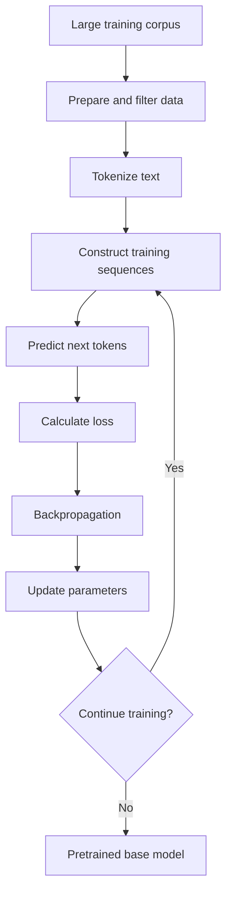
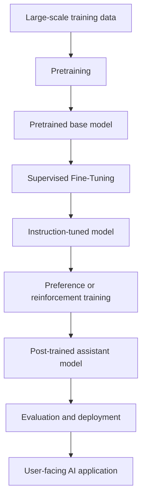

# M1.4 — How LLMs Learn

- **Module ID:** M1.4
- **Module:** How LLMs Learn
- **Category:** Theory + Coding
- **Coding Requirement:** Light
- **Difficulty:** Intermediate
- **Importance:** Core
- **Estimated Study Time:** 4–6 hours
- **Prerequisites:** M1.1 — What an LLM Actually Is; M1.2 — Tokenization; M1.3 — Inside an LLM: Embeddings, Attention & Transformers

## Table of Contents

1. [Start Here: The Big Picture](#1-start-here-the-big-picture)
2. [Lesson 1 — How Does an LLM Learn?](#2-lesson-1--how-does-an-llm-learn)
3. [Lesson 2 — Pretraining and Self-Supervised Learning](#3-lesson-2--pretraining-and-self-supervised-learning)
4. [Lesson 3 — How Pretraining Works Step by Step](#4-lesson-3--how-pretraining-works-step-by-step)
5. [Lesson 4 — What Does Pretraining Teach?](#5-lesson-4--what-does-pretraining-teach)
6. [Lesson 5 — Memorization vs. Generalization](#6-lesson-5--memorization-vs-generalization)
7. [Lesson 6 — Why Pretraining Is Not Enough](#7-lesson-6--why-pretraining-is-not-enough)
8. [Lesson 7 — Supervised Fine-Tuning (SFT)](#8-lesson-7--supervised-fine-tuning-sft)
9. [Lesson 8 — Preference Learning: RLHF, RLAIF, and DPO](#9-lesson-8--preference-learning-rlhf-rlaif-and-dpo)
10. [Lesson 9 — Safety Tuning and Assistant Behavior](#10-lesson-9--safety-tuning-and-assistant-behavior)
11. [Lesson 10 — Follow the Complete Learning Pipeline](#11-lesson-10--follow-the-complete-learning-pipeline)
12. [Lesson 11 — Base Model vs. Instruction-Tuned Model](#12-lesson-11--base-model-vs-instruction-tuned-model)
13. [Lesson 12 — Choosing the Right Engineering Approach](#13-lesson-12--choosing-the-right-engineering-approach)
14. [Common Misconceptions](#14-common-misconceptions)
15. [Interview Preparation](#15-interview-preparation)
16. [Exercises and Answer Guide](#16-exercises-and-answer-guide)
17. [Chapter Summary and Completion Checklist](#17-chapter-summary-and-completion-checklist)
18. [What to Learn Next](#18-what-to-learn-next)

---

## 1. Start Here: The Big Picture

Imagine that you have built a language model that can continue a piece of text. You give it:

> The capital of Nepal is ...

The model must predict what comes next. It may assign a high probability to `Kathmandu`, a lower probability to other cities, and probabilities to many other possible tokens.

At first, its predictions may be poor. During training, it sees enormous amounts of text, compares its predictions with the actual next tokens, and adjusts its internal parameters. Repeating this process allows it to learn patterns from language and other data.

But there is a second problem: **being good at continuing text is not the same as being a good assistant.**

A model that has learned from books, websites, and code may be able to continue a paragraph, yet still fail to follow a request such as:

> Explain overfitting in exactly three bullet points.

It might produce a continuation that resembles its training data rather than a direct, well-structured answer. To encourage assistant-like behavior, developers apply additional training after pretraining.

This chapter teaches two connected ideas:

1. **Pretraining:** How a model learns broad patterns from data.
2. **Post-training:** How a pretrained model is adapted to follow instructions and behave more like an assistant.

Keep this distinction in mind as you move through the chapter.

### Learning objectives

By the end of this chapter, you should be able to:

- Explain pretraining and self-supervised learning in your own words.
- Show how next-token prediction creates a training signal from ordinary text.
- Describe what a model may learn during pretraining.
- Distinguish memorization from generalization.
- Explain why a knowledgeable base model may still be a poor conversational assistant.
- Describe supervised fine-tuning (SFT), RLHF, RLAIF, preference optimization, and safety tuning.
- Trace a common pipeline from pretraining to a deployed assistant.
- Compare a base model and an instruction-tuned model using the same prompts.
- Decide when prompting, retrieval-augmented generation (RAG), or fine-tuning may help an AI application.

### How this chapter connects to earlier learning

| Previous module | What it contributes to this chapter |
|---|---|
| M1.1 — What an LLM Actually Is | Introduces next-token prediction and text generation. |
| M1.2 — Tokenization | Explains how text becomes tokens and token IDs. |
| M1.3 — Inside an LLM: Embeddings, Attention & Transformers | Explains how token representations are processed by transformer layers. |
| **M1.4 — How LLMs Learn** | Explains how model parameters are trained and how assistant behavior is shaped. |

**Prerequisites:** You should be familiar with tokens, token IDs, transformer layers, and the idea that an LLM generates text by predicting subsequent tokens. You do not need to know how to train a large model from scratch.

---

## 2. Lesson 1 — How Does an LLM Learn?

Let us begin with a simple question: when an LLM reads a sentence, how can it learn from it?

Consider:

> Birds can usually ...

A language model can assign probabilities to possible next tokens. Depending on the context and its training, it might assign relatively high probabilities to words such as `fly`, `sing`, or `move`.

The model does not begin with a hand-written rule for every sentence. Instead, training adjusts its parameters so that its predictions become more useful across many examples.

### 2.1 The learning loop

The basic loop is:

1. Give the model a sequence of tokens.
2. Ask it to predict the next token at each eligible position.
3. Compare its predictions with the actual next tokens.
4. Calculate a loss that measures prediction error.
5. Calculate gradients using backpropagation.
6. Use an optimizer to update the model parameters.
7. Repeat with more training examples.

A **parameter** is a learned numerical value inside the model. The collection of parameters determines how the model transforms input tokens into predictions.

The model's parameters change during training. During ordinary inference—when you use a trained model to ask a question—its parameters generally remain fixed.

### 2.2 A simple example

Suppose the training sentence is:

> The cat sat on the mat.

A simplified word-level illustration of the prediction targets is:

| Context given to the model | Next-token target |
|---|---|
| `The` | `cat` |
| `The cat` | `sat` |
| `The cat sat` | `on` |
| `The cat sat on` | `the` |
| `The cat sat on the` | `mat` |

Real LLMs usually use tokenizers that can split text into words, word pieces, punctuation, or other units. The table uses whole words to make the idea easier to see.

Notice something important: the sentence itself supplies the targets. A human does not need to separately label each row.

**Check your understanding:** In this example, where does the correct next-token answer come from?

It comes from the original sequence. This observation leads directly to self-supervised learning.

---

## 3. Lesson 2 — Pretraining and Self-Supervised Learning

### 3.1 What is pretraining?

**Pretraining** is the initial large-scale training stage in which a model learns broad patterns from a large dataset before it is adapted to more specific tasks or behaviors.

For an autoregressive LLM, a common pretraining objective is next-token prediction: given the preceding tokens, predict the next token.

The training data may include books, articles, websites, documentation, source code, and other text. Depending on the model, training can also include non-text data such as images, audio, or video.

### 3.2 What is self-supervised learning?

**Self-supervised learning** is a learning approach in which the training targets are derived from the data itself instead of requiring a person to manually label every example.

In the sentence:

> Machine learning models discover patterns.

the next token in the sequence supplies the target for each prediction position.

This is still a supervised training signal in the broad mathematical sense: the model has a target to learn from. The important distinction is that the target is generated from the data rather than manually annotated for every token.

### 3.3 Why next-token prediction works as a learning signal

At a given position, the model produces a probability distribution over possible next tokens.

Imagine the context is:

> The capital of Nepal is

The model might assign these illustrative probabilities:

| Candidate next token | Illustrative probability |
|---|---:|
| `Kathmandu` | 0.70 |
| `Pokhara` | 0.10 |
| `a` | 0.05 |
| All other tokens combined | 0.15 |

These numbers are only an example; they are not measured outputs from a real model.

If the actual target is `Kathmandu`, the model should assign a high probability to that token. If it assigns a low probability, the training loss will generally be higher.

### 3.4 Cross-entropy loss

A common objective for next-token prediction is cross-entropy loss:

$$
\mathcal{L}(\theta)
=
-\frac{1}{N}
\sum_{t=1}^{N}
\log P_{\theta}(x_t \mid x_{<t})
$$


Here:

- \(\mathcal{L}(\theta)\) is the average loss.
- \(\theta\) represents the model parameters.
- \(N\) is the number of target tokens evaluated.
- \(x_t\) is the correct token at position \(t\).
- \(x_{<t}\) represents all preceding tokens.
- \(P_\theta(x_t \mid x_{<t})\) is the probability the model assigns to the correct token given its context.

Do not worry about memorizing the equation before understanding its meaning. The central idea is straightforward:

**The model is penalized when it assigns a low probability to the correct next token.**

Training aims to reduce this loss across many examples.

### 3.5 How the parameters learn

The model first makes predictions using its current parameters. The training process calculates the loss and then computes gradients, which indicate how changes in parameters affect the loss.

An optimizer uses those gradients to update the parameters. The process repeats over many batches.

A simplified view is:

\[
\text{Predict}
\rightarrow
\text{Calculate Loss}
\rightarrow
\text{Calculate Gradients}
\rightarrow
\text{Update Parameters}
\rightarrow
\text{Repeat}
\]

This is a conceptual representation of the training loop. Actual implementations include additional details such as batching, learning-rate schedules, numerical precision, and optimization strategies.

### 3.6 What self-supervised learning does not mean

Self-supervised learning does not mean that:

- The model learns without a training objective.
- The model's predictions are automatically correct.
- The training data is necessarily accurate or unbiased.
- Human oversight is unnecessary throughout model development.
- The model learns objective truth rather than patterns in the available data.

The training signal can be generated automatically, but the quality and limitations of the data remain important.

**Check your understanding:** Why is next-token prediction called self-supervised?

Because the next token already present in the sequence supplies the target. A human does not need to annotate every individual prediction.

---

## 4. Lesson 3 — How Pretraining Works Step by Step

Now that you understand the learning objective, follow the process from raw text to a pretrained model.

### Step 1: Collect and prepare training data

A training corpus may contain many kinds of text, including books, websites, articles, programming documentation, and source code.

Before training, data may be filtered, deduplicated, reformatted, or checked for quality. The exact preparation process depends on the model.

Why does this matter? If the data contains errors, unwanted content, or repeated material, those characteristics can influence what the model learns.

### Step 2: Tokenize the text

The text is converted into token IDs using a tokenizer.

```text
Text:      "Models learn patterns."
Token IDs: [1201, 489, 734]
```

These token IDs are placeholders used for illustration, not the output of a specific tokenizer.

The model processes token IDs rather than ordinary text directly. This is the connection to M1.2, which covers tokenization.

### Step 3: Construct training sequences

A sequence of tokens provides multiple prediction targets.

For example, given:

\[
[x_1, x_2, x_3, x_4]
\]

the model learns to predict:

\[
P(x_2 \mid x_1)
\]

\[
P(x_3 \mid x_1, x_2)
\]

\[
P(x_4 \mid x_1, x_2, x_3)
\]

In many transformer implementations, predictions for multiple positions are calculated in parallel during training. A causal attention mask prevents a position from using future tokens to predict its target.

### Step 4: Predict the next tokens

The transformer processes the input representations and produces a probability distribution over possible next tokens at each eligible position.

The model's predictions depend on its current parameters and the context available at that position.

### Step 5: Calculate the loss

The training process compares the predictions with the actual next-token targets. Cross-entropy loss is a common way to quantify how well the model predicts those targets.

### Step 6: Update the parameters

Backpropagation calculates gradients, and an optimizer updates the parameters to reduce the training objective.

### Step 7: Repeat at scale

The process continues across many batches and a planned quantity of training data. Large-scale pretraining may require substantial compute and careful engineering.

### The complete workflow



The output is a pretrained model whose parameters have been adjusted to improve the training objective. That does not automatically make it a reliable assistant.

**Important distinction:** Training optimizes an objective. It does not guarantee factual accuracy, strong reasoning, instruction-following, or safe behavior in every situation.

---

## 5. Lesson 4 — What Does Pretraining Teach?

You might wonder how a task as simple as predicting the next token can lead to abilities such as writing, coding, and answering questions.

Consider the diversity of the training data. Predicting the next token in a Python program requires different patterns from predicting the next token in a scientific explanation or a conversation.

To reduce prediction error across many contexts, the model can benefit from learning representations of language, concepts, relationships, and recurring structures.

### 5.1 Capabilities that may emerge through pretraining

| Capability | What the model may learn | Example |
|---|---|---|
| Grammar | Common syntactic patterns | Producing a grammatically structured sentence |
| Facts and associations | Relationships expressed in training data | Associating Nepal with Kathmandu |
| Language patterns | Word usage, style, and context | Continuing a formal paragraph |
| Concepts | Representations of recurring ideas | Associating a triangle with three sides |
| Relationships | Patterns between entities and ideas | Connecting a person with an occupation in a relevant context |
| Coding syntax | Programming language structures | Completing a Python function |
| Problem-solving patterns | Repeated solution structures in training data | Following a familiar arithmetic explanation |
| Document structure | Formatting and organizational conventions | Producing headings or lists |

These are capabilities the model may develop; they are not guaranteed to appear equally strongly in every model.

### 5.2 Why does one model perform many tasks?

A model trained on diverse data can learn patterns that are useful across multiple tasks. The same underlying model may generate an explanation, summarize a passage, translate text, write code, or answer a question.

This does not mean that every task is equally reliable. Performance depends on the model, the prompt, the context, and the task.

### 5.3 Does the model store facts?

A language model's parameters encode patterns acquired during training. Some information may be memorized, while other information may be represented in ways that support generalization.

Therefore, an LLM is neither simply a database of stored answers nor a system that never memorizes anything.

Its learned information is encoded in model parameters in a way that differs from ordinary explicit database records.

### 5.4 What pretraining does not guarantee

Pretraining does not guarantee that a model:

- Knows every fact in its training data.
- Always recalls information correctly.
- Has current information about events after its training.
- Applies every learned pattern correctly.
- Produces a useful response to every instruction.
- Understands every question in the way a human would.

The distinction between learning patterns and reliably using those patterns becomes clearer when we study memorization and generalization.

---

## 6. Lesson 5 — Memorization vs. Generalization

Two important ideas help explain how a model uses what it has learned.

**Memorization** means reproducing specific information or patterns encountered during training.

**Generalization** means applying learned patterns to inputs or combinations that were not encountered in exactly the same form during training.

### 6.1 Memorization example

Suppose a model encountered this sentence during training:

> The chemical symbol for gold is Au.

The model may reproduce that association when asked about gold's chemical symbol.

However, observing the correct answer alone does not prove whether it came from direct memorization, a broader learned association, or a combination of both.

### 6.2 Generalization example

Suppose a model has learned common Python syntax and has seen many examples of loops.

It may generate a valid loop for a new task even if that exact program did not appear in its training data.

This illustrates generalization when the model correctly applies learned patterns to a new combination of requirements.

### 6.3 Comparison

| Aspect | Memorization | Generalization |
|---|---|---|
| Main behavior | Reproduces specific learned information or patterns | Applies learned patterns to a new situation |
| Example | Reproducing a sentence found in training data | Answering a differently worded question about a familiar concept |
| Dependence on exact examples | Often high for reproduced content | Can draw on patterns learned across many examples |
| Benefit | Retains useful information and conventions | Supports flexible responses to new inputs |
| Risk | May reproduce unwanted or inaccurate training content | May apply a familiar pattern incorrectly |

### 6.4 How can an LLM answer a question it has never seen verbatim?

A model does not need to encounter every possible sentence during training. It can learn reusable patterns that support responses to different combinations of familiar concepts.

Imagine that the training data contains:

- Facts about Kathmandu.
- Questions about capital cities.
- Different ways of phrasing geographic questions.

The model may combine these patterns to answer:

> Which city serves as Nepal's national capital?

The exact wording may be new even though the relevant facts and language patterns are familiar.

### 6.5 Generalization is not the same as correctness

A model may apply a familiar pattern to the wrong context, combine facts incorrectly, or generate a plausible but false answer.

Memorized information can also be inaccurate or outdated.

For this reason, a fluent response should not be treated as proof that the model has retrieved a correct fact or reasoned reliably.

**Engineering lesson:** Evaluate the model's outputs against the application's requirements. Do not assume that fluency proves correctness.

---

## 7. Lesson 6 — Why Pretraining Is Not Enough

At this point, you have learned how pretraining develops broad predictive capabilities. But consider the following prompt:

> Explain overfitting in exactly three bullet points.

A base model might produce a useful answer. It might also continue the text in an unexpected style, generate an overly long passage, or fail to follow the requested format.

Why? Its primary training objective was to predict text continuations, not necessarily to behave as a helpful assistant.

### 7.1 What is post-training?

**Post-training** refers to additional training stages performed after pretraining to adapt a model to particular tasks, preferences, or behavioral expectations.

For chat-oriented LLMs, post-training commonly encourages the model to:

- Follow user instructions.
- Respond conversationally.
- Use appropriate answer structures.
- Handle ambiguity more effectively.
- Refuse certain harmful requests.
- Express uncertainty when appropriate.

### 7.2 The broad pipeline

\[
\boxed{
\text{Pretraining}
\rightarrow
\text{SFT}
\rightarrow
\text{Preference / Reinforcement Training}
\rightarrow
\text{Deployed Assistant}
}
\]

This is a common conceptual pipeline, not a mandatory recipe. Some models omit stages, change their order, or use alternative optimization methods.

### 7.3 The two stages compared

| Aspect | Pretraining | Post-training |
|---|---|---|
| Main purpose | Learn broad patterns from data | Shape useful assistant behavior |
| Typical data | Large training corpora | Demonstrations, preferences, and task-specific examples |
| Typical objective | Predict the next token | Encourage desired responses and behavior |
| Human supervision | Not required for every training token | May include human-written examples and preferences |
| Result | Pretrained base model | Adapted model, often an instruction-tuned or chat model |
| Limitation | May not consistently follow instructions | Can still make mistakes or behave undesirably |

### 7.4 Why this distinction matters

A model may have learned facts and coding patterns during pretraining but still need additional training to use those capabilities in a user-friendly way.

Post-training does not replace pretraining. It adapts an existing model using further examples and objectives.

**Key idea:** Pretraining primarily develops broad predictive capabilities; post-training shapes how those capabilities are expressed in assistant interactions.

---

## 8. Lesson 7 — Supervised Fine-Tuning (SFT)

### 8.1 Learn through examples

Imagine that you are teaching a student how to answer questions. Instead of only asking the student to read books, you show examples of good answers.

For example:

**User:** Explain overfitting simply.

**Desired assistant response:** Overfitting occurs when a model learns the training data too closely and performs poorly on new data.

When a model is trained on many examples of instructions paired with suitable responses, it can learn patterns of how an assistant should respond.

This is the central idea behind **Supervised Fine-Tuning (SFT)**.

### 8.2 Formal definition

SFT is a training stage in which a pretrained model is further trained on examples demonstrating desired inputs and outputs.

For an assistant, the examples often contain user instructions paired with suitable assistant responses.

### 8.3 Examples of SFT data

| User instruction | Desired assistant response |
|---|---|
| Explain overfitting simply. | A concise and accurate beginner-friendly explanation |
| List three benefits of version control. | Three relevant, clearly formatted points |
| Return the answer as JSON. | A valid JSON object matching the requested structure |

These examples teach patterns of appropriate responses. The model does not need a separate hand-written rule for every possible prompt.

### 8.4 How SFT works

1. Prepare examples of instructions and desired responses.
2. Format them using the model's training format.
3. Tokenize the sequences.
4. Calculate the training loss over designated target tokens.
5. Update model parameters to make the demonstrated responses more likely.

In many implementations, loss is calculated primarily on assistant-response tokens rather than user-message tokens. The exact approach depends on the training setup.

### 8.5 The SFT objective

For a prompt \(x\) and a target response \(y\), SFT commonly maximizes the likelihood of the demonstrated response:

\[
\max_\theta \log P_\theta(y \mid x)
\]

Equivalently, it minimizes negative log-likelihood:

\[
\mathcal{L}_{\text{SFT}}(\theta)
=
-\log P_\theta(y \mid x)
\]

Here, \(\theta\) represents the model parameters. For a multi-token response, its log probability is commonly calculated by summing conditional token log probabilities.

The intuition is simple: training encourages the model to produce responses similar to the desired demonstrations in relevant contexts.

### 8.6 What SFT improves

SFT can improve:

- Instruction-following.
- Conversational structure.
- Adherence to requested formats.
- Task-specific behavior.
- Consistency with demonstrated response patterns.

### 8.7 What SFT cannot guarantee

SFT does not guarantee that a model:

- Always follows instructions correctly.
- Knows whether every answer is true.
- Handles every unseen situation.
- Refuses every unsafe request.
- Produces consistently high-quality answers across all topics.

If the demonstrations are incomplete, incorrect, or inconsistent, the model may learn undesirable behavior.

**Check your understanding:** What is the main difference between pretraining and SFT?

Pretraining commonly teaches a model to predict next tokens across broad data. SFT further trains it on examples of desired input-output behavior.

---

## 9. Lesson 8 — Preference Learning: RLHF, RLAIF, and DPO

SFT teaches a model by showing desired responses. But for many open-ended tasks, there is more than one acceptable answer.

Consider the request:

> Explain a neural network to a beginner.

One response might use a clear analogy and a concise definition. Another might contain excessive technical jargon.

Both are text continuations, but one may be more useful for the intended audience.

Preference-based training helps communicate which responses are better according to selected criteria.

### 9.1 Preference comparisons

Suppose an evaluator compares two responses:

- **Response A:** Accurate, clear, and appropriate for a beginner.
- **Response B:** Difficult to understand and unnecessarily technical.

If Response A is preferred, that comparison provides a learning signal.

Preferences can reflect correctness, relevance, helpfulness, clarity, safety, and other criteria. What counts as better depends on the task and evaluation guidelines.

### 9.2 RLHF: Reinforcement Learning from Human Feedback

**RLHF** is a family of approaches that use human feedback to help optimize model behavior.

A common conceptual pipeline is:

1. **Supervised fine-tuning:** Train on examples of desired responses.
2. **Candidate generation:** Generate multiple responses to selected prompts.
3. **Human preference collection:** Ask human evaluators to compare or rank candidate responses.
4. **Reward modeling:** In a common implementation, train a reward model to predict preferences.
5. **Policy optimization:** Use a reinforcement-learning algorithm, such as Proximal Policy Optimization (PPO), to optimize the language model against the reward signal. This often includes a constraint to limit divergence from a reference model.

A reward model predicts a score associated with a response according to the preferences represented in its training data. It is not an objective measure of truth.

This is one common RLHF approach, not a universal recipe for every model.

### 9.3 RLAIF: Reinforcement Learning from AI Feedback

**RLAIF** uses AI-generated feedback instead of relying exclusively on human preference labels.

A typical process is:

1. Generate candidate responses.
2. Ask an evaluator model to compare them using defined criteria.
3. Convert the comparisons into preference or reward signals.
4. Optimize the target model using an appropriate method.

RLAIF can scale feedback collection, but an evaluator model can be incorrect, biased, or inconsistent. Its preferences may not align perfectly with human expectations.

Human evaluation remains useful for checking whether AI-generated feedback and resulting behavior meet the intended requirements.

### 9.4 DPO: Direct Preference Optimization

**Direct Preference Optimization (DPO)** is a preference-optimization method that uses pairs of preferred and less-preferred responses to optimize a language model directly.

In its standard formulation, DPO does not require a separately trained reward model or a conventional online reinforcement-learning loop.

For example:

| Prompt | Preferred response | Less-preferred response |
|---|---|---|
| Explain recursion simply. | Clear explanation with an example | Confusing explanation with unnecessary jargon |
| Answer in two sentences. | Correct answer in two sentences | Correct but excessively long answer |
| Help debug this code. | Relevant diagnosis and a possible fix | Unrelated or unsupported suggestion |

DPO uses these comparisons to encourage preferred outputs relative to less-preferred ones according to its optimization objective.

DPO and RLHF are related through preference learning, but they are not identical methods. RLHF often refers to approaches that explicitly use reinforcement learning from feedback, while DPO is generally classified as direct preference optimization.

### 9.5 Compare the approaches

| Method | Main training signal | Typical purpose | Important limitation |
|---|---|---|---|
| SFT | Demonstrations of desired responses | Teach instruction-following and response patterns | Limited by demonstration quality |
| RLHF | Human preferences, commonly through a reward model | Optimize behavior according to human feedback | Human judgments and reward models can be imperfect |
| RLAIF | AI-generated feedback or preferences | Scale preference supervision | Evaluator errors and biases can propagate |
| DPO | Preferred and less-preferred response pairs | Direct preference optimization | Depends on data quality and optimization assumptions |

These approaches can be combined or used in different training recipes.

### 9.6 Why preference optimization is useful

SFT provides examples of what a good response looks like. Preference comparisons can additionally communicate which of two responses is more desirable when both are possible.

However, optimizing preferences does not guarantee that every response will be correct or that every user will prefer it. The results depend on the quality and coverage of the feedback.

---

## 10. Lesson 9 — Safety Tuning and Assistant Behavior

### 10.1 What is safety tuning?

**Safety tuning** refers to training and related model-development techniques intended to reduce harmful or policy-violating outputs and encourage safer responses.

Examples may teach a model to:

- Decline requests that would facilitate serious harm.
- Avoid exposing sensitive information.
- Distinguish harmless educational questions from harmful operational requests.
- Offer safer alternatives where appropriate.
- Express uncertainty when evidence is insufficient.

Safety tuning can use supervised demonstrations, preference data, reinforcement-learning methods, AI feedback, or combinations of these approaches.

### 10.2 Example of a refusal

**User request:**

> Help me access another person's account without permission.

A safety-tuned assistant should not provide instructions for unauthorized access. Depending on the context, it may redirect the user to legitimate account recovery or defensive security practices.

### 10.3 Why does a chat model behave like an assistant?

Post-training can encourage several behaviors:

| Observed behavior | How post-training can contribute | Limitation |
|---|---|---|
| Follows instructions | SFT demonstrates how to respond to requests | Complex or conflicting instructions can still fail |
| Answers conversationally | Examples establish assistant-style responses | Style varies by model |
| Structures answers | Demonstrations favor useful lists and formats | Formatting can still fail |
| Refuses certain requests | Safety examples and preferences encourage refusals | Refusals can be too broad or incomplete |
| Hedges or expresses uncertainty | Training can favor qualified answers when evidence is incomplete | Confidence can still be poorly calibrated |
| Asks for clarification | Examples can encourage clarification when important details are missing | Models can ask unnecessary questions or miss necessary ones |
| Prioritizes helpfulness | Preferences can reward relevant and useful responses | Helpfulness does not guarantee factual accuracy |

### 10.4 Why might a model hedge?

A model may have learned that qualified answers are preferred when information is incomplete or a question is ambiguous.

For example:

> Based on the information provided, the most likely explanation is ...

This can be useful when uncertainty is genuine. However, hedging can also be excessive or poorly calibrated. Uncertainty language does not prove that the model has correctly estimated its confidence.

### 10.5 Why might a model ask a clarifying question?

Consider:

**User:** Find a restaurant for dinner.

If the assistant does not know the relevant city or area, it may ask for that information instead of guessing.

Post-training can encourage this behavior because clarification may produce a more useful answer than an unsupported assumption.

### 10.6 Why might a model refuse?

Training can encourage the model to avoid certain categories of harmful assistance. The model learns patterns associated with refusal and safer alternatives.

A refusal is a learned behavioral response, not proof that the model has perfectly understood the request or applied a flawless safety policy.

### 10.7 Safety tuning is not a complete safety system

A model may still misclassify a request, refuse a harmless question, be manipulated by adversarial instructions, or generate false information.

For production applications, model-level safety behavior should be combined with appropriate application controls, authorization, data handling, monitoring, and evaluation.

**Key lesson:** Post-training influences how a model responds, but it cannot guarantee that every response will be correct, useful, or safe.

---

## 11. Lesson 10 — Follow the Complete Learning Pipeline

Now connect all the concepts into one continuous story.

Imagine you want to build an assistant that helps students understand programming concepts.

### Stage 1: Pretraining

The model learns from large amounts of text and code. It develops patterns related to programming syntax, explanations, error messages, and common concepts.

**What this stage contributes:** Broad predictive capabilities.

### Stage 2: Supervised Fine-Tuning

The model receives examples of students asking programming questions and assistants responding with explanations, corrected code, and debugging guidance.

**What this stage contributes:** Demonstrated instruction-following and response patterns.

### Stage 3: Preference or Reinforcement Training

The model may receive feedback favoring accurate, relevant, understandable debugging responses over confusing or unsupported responses.

**What this stage contributes:** Additional shaping of which responses are preferred.

### Stage 4: Evaluation and deployment

The model is tested and integrated into an application. Developers evaluate correctness, formatting, safety, latency, and other requirements.

**What this stage contributes:** A model that can be used within an engineered application, subject to its limitations.

### The common pipeline



This diagram shows a common conceptual pipeline. Not every model uses every stage, and evaluation can occur at multiple points.

### What changes during training?

Let the model parameters be represented by \(\theta\).

Pretraining produces a parameter set through optimization on a pretraining dataset:

\[
\theta_{\text{pretrained}}
=
\operatorname{Train}_{\text{pretraining}}
(\theta_0, D_{\text{pretraining}})
\]

SFT further adapts the parameters using instruction-response examples:

\[
\theta_{\text{SFT}}
=
\operatorname{Train}_{\text{SFT}}
(\theta_{\text{pretrained}}, D_{\text{SFT}})
\]

Additional preference training may produce a further-adapted parameter set:

\[
\theta_{\text{final}}
=
\operatorname{Train}_{\text{post-training}}
(\theta_{\text{SFT}}, D_{\text{preferences}})
\]

These are conceptual equations, not exact implementations of a particular framework. Actual training may include multiple objectives, reference models, reward models, adapters, or alternative stages.

### Training versus inference

| Aspect | Training | Inference |
|---|---|---|
| Purpose | Adjust parameters to improve an objective | Generate outputs using existing parameters |
| Inputs | Training examples and targets or feedback | A prompt and optional context |
| Parameter updates | Yes | Normally no |
| Output | Updated model parameters | Generated tokens or responses |
| Cost | Can be very high at foundation-model scale | Depends on model size, context, output length, and serving setup |

When you send a prompt to a deployed model, it normally generates a response using its existing parameters rather than retraining itself after each message. The surrounding application may retain conversation history or retrieve external information without changing those parameters.

---

## 12. Lesson 11 — Base Model vs. Instruction-Tuned Model

This experiment connects the theory to observable behavior.

### 12.1 Objective

Compare two compatible models from the same family:

- **Base model:** Primarily pretrained for next-token prediction.
- **Instruction-tuned model:** Further trained to respond to instructions.

Use the same prompts and compare the responses.

### 12.2 Prerequisites

- Python 3.10 or later.
- Basic familiarity with Python environments.
- Two compatible models from the same family.
- Sufficient memory and compute, or an appropriate inference provider.

For a local demonstration, choose a small model pair whose licenses and access requirements permit your use. The code below is a template, not a guarantee that arbitrary model IDs will work.

Install dependencies:

```bash
pip install torch transformers
```

### 12.3 Load the models

Replace the placeholders with actual, compatible model identifiers.

```python
import torch
from transformers import AutoModelForCausalLM, AutoTokenizer

BASE_MODEL_ID = "REPLACE_WITH_BASE_MODEL_ID"
INSTRUCT_MODEL_ID = "REPLACE_WITH_INSTRUCTION_MODEL_ID"

device = "cuda" if torch.cuda.is_available() else "cpu"


def load_model(model_id):
    tokenizer = AutoTokenizer.from_pretrained(model_id)
    model = AutoModelForCausalLM.from_pretrained(model_id)

    model = model.to(device)
    model.eval()

    return tokenizer, model


base_tokenizer, base_model = load_model(BASE_MODEL_ID)
instruct_tokenizer, instruct_model = load_model(INSTRUCT_MODEL_ID)
```

Some models require authentication, additional access permissions, specific loading configurations, or more memory than your machine has available. The example loads models using their default parameter precision.

### 12.4 Generate a response

```python
def generate_response(
    tokenizer,
    model,
    prompt,
    max_new_tokens=100,
):
    inputs = tokenizer(
        prompt,
        return_tensors="pt",
    ).to(device)

    with torch.inference_mode():
        outputs = model.generate(
            **inputs,
            max_new_tokens=max_new_tokens,
            do_sample=False,
            pad_token_id=tokenizer.eos_token_id,
        )

    input_length = inputs["input_ids"].shape[1]
    new_tokens = outputs[0][input_length:]

    return tokenizer.decode(
        new_tokens,
        skip_special_tokens=True,
    )
```

The function:

1. Converts the prompt into token IDs.
2. Moves input tensors to the selected device.
3. Generates new tokens without updating model parameters.
4. Separates generated tokens from the original input.
5. Decodes the tokens into text.

With `do_sample=False`, generation is greedy in this basic example. This makes comparisons easier, but it does not guarantee identical results across every model, software configuration, or hardware environment.

### 12.5 Compare identical prompts

```python
prompts = [
    "Explain overfitting in three bullet points.",
    "Write a Python function that checks whether a number is even.",
    "Explain recursion to a beginner using a simple example.",
]

for prompt in prompts:
    print(f"\nPROMPT: {prompt}")

    base_output = generate_response(
        base_tokenizer,
        base_model,
        prompt,
    )

    instruct_output = generate_response(
        instruct_tokenizer,
        instruct_model,
        prompt,
    )

    print("\nBASE MODEL:")
    print(base_output)

    print("\nINSTRUCTION-TUNED MODEL:")
    print(instruct_output)
    print("-" * 60)
```

### 12.6 Observe the results

Do not assume that one model will win every comparison. Examine the actual responses.

| Prompt | What to evaluate |
|---|---|
| Explain overfitting in three bullet points. | Does it follow the requested format? |
| Write a Python function that checks whether a number is even. | Is the code correct and relevant? |
| Explain recursion to a beginner. | Is the explanation understandable for the intended audience? |

Record your observations:

| Prompt | Base model behavior | Instruction-tuned behavior | Your conclusion |
|---|---|---|---|
| Prompt 1 | Record output | Record output | Compare format and relevance |
| Prompt 2 | Record output | Record output | Check correctness |
| Prompt 3 | Record output | Record output | Compare clarity |

### 12.7 Control the experiment

For a meaningful comparison:

- Use models from the same family where possible.
- Keep prompt text identical.
- Use comparable output limits and generation settings.
- Follow each model's documented input format.
- Repeat the comparison across multiple prompts.
- Evaluate correctness as well as formatting and helpfulness.
- Record model IDs and configurations.

**Important limitation:** Identical raw text does not always produce equivalent effective inputs. Instruction-tuned models may expect special chat-template tokens. Follow the documentation for each model rather than assuming every model accepts the same format.

### 12.8 Interpret the findings

If the instruction-tuned model follows the requested format more consistently, this supports the idea that post-training can improve instruction-following behavior.

It does not prove that the model has more factual knowledge, reasons better in every case, or differs only because of SFT. Training data and additional post-training stages can also influence behavior.

The goal is to observe a difference and connect it to the learning process.

---

## 13. Lesson 12 — Choosing the Right Engineering Approach

Understanding how models learn helps you decide how to improve an AI application.

Suppose you build a university question-answering assistant and it repeatedly gives outdated examination dates. Should you fine-tune the model?

Not necessarily. First identify the actual problem.

### 13.1 Pretraining, fine-tuning, RAG, and prompting

| Approach | What it changes or provides | Best suited to | Main limitation |
|---|---|---|---|
| Pretraining | Learns broad patterns by optimizing model parameters | Creating a foundation model | Expensive at large scale |
| Fine-tuning | Updates model parameters using additional training data | Adapting behavior, style, or task performance | Requires suitable training data and evaluation |
| RAG | Supplies relevant external information at inference time | Answering from private, changing, or source-specific documents | Retrieval can fail, and the model can misinterpret sources |
| Prompt engineering | Changes the instructions and context supplied to the model | Clarifying the task and controlling response structure | Cannot guarantee compliance or supply missing knowledge by itself |

### 13.2 Diagnose the failure before choosing a solution

| Situation | Possible starting approach | Reason |
|---|---|---|
| The prompt is ambiguous | Improve the prompt or request clarification | The model needs clearer instructions |
| The answer requires current or private information | Consider RAG | The model needs relevant external information |
| The model repeatedly fails to follow a response format | Improve instructions and validate structured output; evaluate fine-tuning if needed | The failure concerns response behavior |
| The application requires domain-specific behavior | Evaluate fine-tuning with suitable examples | Additional training may improve the desired behavior |
| The model produces harmful outputs | Evaluate safety behavior and application-level safeguards | Training alone cannot guarantee safety |

These are starting points, not universal rules. The best approach depends on the failure mode, data availability, model access, cost, latency, and reliability requirements.

### 13.3 Example: A university assistant

Suppose the assistant must answer:

> When is the next database systems examination?

If the date changes regularly, a fine-tuned model may still produce an outdated answer. RAG can retrieve the latest examination schedule from an appropriate source.

If the assistant also needs to respond in a consistent format, instructions or fine-tuning may help shape its behavior.

This illustrates the difference between providing information and shaping response behavior.

### 13.4 Practical model-selection checklist

Before integrating a model into an application, ask:

- [ ] Does it follow the required instructions?
- [ ] Does it produce accurate answers on representative tests?
- [ ] Does it handle missing or ambiguous information appropriately?
- [ ] Does it follow the required output schema?
- [ ] Does it handle unsafe requests appropriately?
- [ ] Does it meet latency and cost requirements?
- [ ] Does its license permit the intended use?
- [ ] Does it perform adequately on the relevant languages and domain data?

A model's training history can help explain its behavior, but application-specific evaluation should determine whether it is suitable.

---

## 14. Common Misconceptions

| Misconception | Correct understanding |
|---|---|
| Pretraining requires humans to label every next token. | The next token is already present in the training sequence. |
| Self-supervised learning has no training signal. | It uses targets derived from the data itself. |
| Pretraining teaches only grammar. | It can develop patterns related to facts, concepts, code, and relationships. |
| An LLM is just a database. | Model parameters encode learned patterns and may also memorize information. |
| A model never memorizes training data. | Memorization and generalization can coexist. |
| Generalization guarantees correctness. | A model can apply learned patterns incorrectly. |
| A base model cannot answer questions. | It may answer many questions, but it is primarily optimized for text continuation. |
| SFT guarantees perfect instruction-following. | SFT encourages behavior demonstrated in training examples. |
| RLHF and DPO are identical. | Their standard optimization approaches differ. |
| RLAIF eliminates the need to evaluate feedback. | AI evaluators can make mistakes and exhibit bias. |
| Safety tuning makes a model completely safe. | Safety tuning can reduce risks but cannot eliminate them. |
| A fluent answer is necessarily true. | Fluency does not guarantee factual correctness. |
| Fine-tuning is always better than prompting. | The right intervention depends on the failure mode. |

### Practical troubleshooting

| Problem | Likely cause | Possible solution |
|---|---|---|
| Model identifier cannot be found | Invalid placeholder or unavailable model | Use a valid model identifier |
| Access is denied | The model requires permission or authentication | Review access requirements |
| Out-of-memory error | The model exceeds available RAM or GPU memory | Use a smaller model or suitable inference environment |
| Models use incompatible tokenizers | The selected pair is incompatible | Choose a compatible model pair |
| Base model generates unexpected continuations | It is not optimized specifically for assistant behavior | Compare it with an instruction-tuned model |
| Instruction-tuned model ignores the format | Ambiguous prompt, model limitation, or incorrect input template | Verify formatting and improve evaluation prompts |
| Outputs vary between runs | Generation settings or system nondeterminism | Record and control settings |

---

## 15. Interview Preparation

### Foundational questions

**1. What is pretraining?**

Pretraining is the initial training stage in which a model learns broad patterns from a large dataset. Autoregressive LLMs commonly use next-token prediction as their main objective.

**2. What is self-supervised learning?**

It is a learning approach in which targets are derived from the data itself. In next-token prediction, the next token supplies the target.

**3. What is post-training?**

Post-training consists of additional training stages that adapt a pretrained model to tasks, instructions, preferences, or behavioral requirements.

**4. What is the difference between a base model and an instruction-tuned model?**

A base model is primarily pretrained for token prediction. An instruction-tuned model has undergone additional training intended to improve its ability to respond to instructions.

### Conceptual questions

**5. Why can next-token prediction teach more than grammar?**

Predicting tokens across diverse contexts encourages the model to learn patterns involving syntax, semantics, facts, relationships, code, and other structures that help reduce prediction error.

**6. What is the difference between memorization and generalization?**

Memorization involves reproducing specific learned information or patterns. Generalization involves applying learned patterns to inputs that differ from training examples. A model can exhibit both.

**7. Why can an LLM answer a question it has never seen verbatim?**

It can combine learned language patterns, factual associations, and other representations to respond to new wording or combinations. The answer can still be incorrect.

**8. Why can a pretrained model be knowledgeable but poor at conversation?**

Pretraining optimizes a predictive objective rather than directly optimizing every behavior expected of an assistant. Post-training provides demonstrations and preference signals that encourage more useful conversational behavior.

### Technical questions

**9. How does next-token prediction calculate training loss?**

The model assigns probabilities to candidate next tokens. Cross-entropy loss penalizes low probability assigned to the correct target. Backpropagation and an optimizer use the resulting gradients to update model parameters.

**10. What is SFT?**

SFT trains a pretrained model on examples of desired inputs and outputs. It typically increases the likelihood of demonstrated responses.

**11. What is RLHF?**

RLHF uses human feedback to optimize model behavior. A common implementation trains a reward model from comparisons and uses a reinforcement-learning algorithm to optimize the language model.

**12. What is RLAIF?**

RLAIF uses AI-generated feedback or preferences as a training signal. It can scale supervision but inherits risks from the evaluator's biases and errors.

**13. How does DPO differ from a conventional RLHF pipeline?**

DPO directly optimizes a model using preferred and less-preferred response pairs in its standard formulation. A conventional reward-model-based RLHF pipeline typically learns a separate reward model and applies reinforcement learning.

**14. Does post-training change model parameters?**

Training-based post-training normally updates parameters, although some methods use adapters or other parameter-efficient techniques. Prompting a deployed model ordinarily does not update its parameters.

### Practical questions

**15. How would you compare a base model and an instruction-tuned model?**

I would use representative identical prompts, compatible input formats, and comparable generation settings. I would evaluate instruction adherence, factual correctness, formatting, and relevance across multiple examples.

**16. Would you fine-tune a model if it gives outdated university schedule information?**

Not automatically. I would consider retrieving the current schedule from a trusted source. Fine-tuning may help with response behavior, but it is not necessarily the best way to maintain changing facts.

### Scenario-based questions

**17. A model answers confidently but incorrectly. Is this a pretraining or post-training problem?**

It could involve both. Pretraining may establish an incorrect association, while post-training may influence how the answer is expressed. I would evaluate the failure and consider grounding, prompting, model selection, or fine-tuning according to the root cause.

**18. A model refuses harmless requests. What would you investigate?**

I would examine prompts, model behavior, safety instructions, and evaluation examples. The issue may reflect overbroad safety behavior or an ambiguous request. Any change should be tested against both harmless and harmful scenarios.

**19. An instruction-tuned model follows the requested format but produces incorrect facts. What does this demonstrate?**

Instruction-following and factual correctness are separate properties. A model can satisfy the requested structure without producing accurate content, so both must be evaluated.

### Common follow-up questions

**20. Does a lower pretraining loss guarantee a better assistant?**

No. It indicates better performance against the evaluated prediction objective, not necessarily better instruction-following, factual reliability, safety, or usefulness in every application.

**21. Does preference optimization guarantee that every user will prefer the model's answers?**

No. Preferences depend on context, criteria, and training data. Optimization encourages certain behaviors but cannot capture every user's needs.

**22. Can a model be instruction-tuned without RLHF?**

Yes. SFT alone can produce an instruction-tuned model. Some pipelines use additional preference optimization, while others do not.

### Rapid revision: 15 facts

1. Pretraining develops broad predictive capabilities.
2. Autoregressive LLMs commonly learn through next-token prediction.
3. Self-supervised targets are derived from the training data.
4. The original sequence supplies next-token targets.
5. Cross-entropy loss measures the probability assigned to correct targets.
6. Backpropagation computes gradients used to update parameters.
7. Pretraining can teach language, factual associations, code, and recurring problem-solving patterns.
8. Memorization and generalization can coexist.
9. Generalization does not guarantee correctness.
10. Post-training adapts model behavior after pretraining.
11. SFT uses demonstrations of desired responses.
12. RLHF uses human feedback; RLAIF uses AI-generated feedback.
13. DPO directly optimizes from preference comparisons in its standard formulation.
14. Safety tuning reduces risks but does not guarantee complete safety.
15. A knowledgeable base model can still be a poor assistant because predictive capability and instruction-following are different objectives.

---

## 16. Exercises and Answer Guide

### Exercise 1 — Explain self-supervised learning

Given the sentence:

> Transformers process token representations.

Explain how this sentence can provide next-token training targets.

**Expected outcome:** Explain that each target token is supplied by the subsequent token in the sequence, subject to tokenization and the training setup.

### Exercise 2 — Trace the training loop

Put these steps in the correct order:

- Update parameters.
- Calculate loss.
- Tokenize the data.
- Predict next tokens.
- Prepare training sequences.
- Calculate gradients.

**Expected outcome:** Describe the loop from data preparation through parameter updates, including repetition across batches.

### Exercise 3 — Memorization or generalization?

Classify each scenario and explain your reasoning.

1. A model reproduces a sentence it encountered during training.
2. A model writes a new Python loop using familiar programming patterns.
3. A model combines familiar facts to answer a differently worded question.

**Expected outcome:** Recognize that the first illustrates memorization, while the second and third can illustrate generalization. A single observed output may not reveal the exact mechanism responsible.

### Exercise 4 — Explain the training pipeline

Draw a diagram that includes pretraining, SFT, preference or reinforcement training, and deployment.

**Expected outcome:** Explain each stage's purpose and recognize that not every model uses every stage.

### Exercise 5 — Compare SFT and preference optimization

Create two responses to the same prompt. Explain how a desired response can be used in SFT and how a preference comparison can favor one response over the other.

**Expected outcome:** Distinguish learning from target responses from learning using relative preferences.

### Exercise 6 — Compare two models

Run the practical experiment in Lesson 11 with at least three prompts. Record the outputs and compare their behavior.

**Expected outcome:** Analyze instruction-following, formatting, relevance, and correctness without assuming that the instruction-tuned model wins every comparison.

### Exercise 7 — Choose an engineering intervention

A university assistant repeatedly provides outdated information about examination dates. Decide whether to prioritize prompting, RAG, or fine-tuning, and justify your decision.

**Expected outcome:** Identify changing external information as a likely retrieval problem and explain why fine-tuning alone is not an ideal way to maintain frequently changing facts.

### Exercise 8 — Evaluate a safety failure

An assistant refuses a harmless request to explain a basic networking concept. List possible causes and propose a way to evaluate a correction.

**Expected outcome:** Recognize possible over-refusal, examine relevant instructions and examples, and test both harmless and harmful scenarios.

### Answer guide

| Exercise | Key points |
|---|---|
| 1 | The sequence provides target tokens; human labels for every token are unnecessary. |
| 2 | Tokenize and prepare sequences, predict tokens, calculate loss, calculate gradients, update parameters, and repeat. |
| 3 | Reproducing a known sentence illustrates memorization; applying familiar patterns to new inputs can illustrate generalization. |
| 4 | Pretraining develops predictive capabilities; SFT teaches demonstrated behavior; preference training can further shape responses; deployment uses the resulting model. |
| 5 | SFT uses desired input-output examples; preference optimization uses comparisons between responses. |
| 6 | Compare observed behavior under controlled conditions. Do not infer factual superiority from formatting alone. |
| 7 | RAG is a strong initial candidate because current facts should come from a current source. |
| 8 | Investigate overbroad safety behavior and evaluate changes against both harmless and harmful test cases. |

---

## 17. Chapter Summary and Completion Checklist

### 17.1 The chapter in one explanation

LLMs commonly learn in two broad stages: pretraining and post-training.

During pretraining, an autoregressive model learns to predict next tokens from large datasets. Because the next token already exists in the training sequence, this provides a self-supervised training signal. Across many examples, the model can learn grammar, facts, concepts, relationships, coding syntax, and other patterns.

Memorization and generalization are both possible. A model may reproduce specific learned information or apply learned patterns to new combinations, but neither behavior guarantees correctness.

Post-training adapts the model toward useful assistant behavior. SFT teaches through demonstrations, while preference-based methods such as RLHF, RLAIF, and DPO use feedback or comparisons to encourage desired responses. Safety tuning can reduce harmful behavior but cannot eliminate all risks.

The central lesson is:

**Pretraining builds broad predictive capabilities; post-training shapes how those capabilities are used in assistant interactions.**

### 17.2 Completion checklist

- [ ] I can explain pretraining and self-supervised learning in my own words.
- [ ] I can trace how a text sequence creates next-token targets.
- [ ] I can explain cross-entropy loss, gradients, and parameter updates conceptually.
- [ ] I can describe the major capabilities acquired during pretraining.
- [ ] I can distinguish memorization from generalization and explain their limitations.
- [ ] I can explain the pipeline from pretraining to a deployed assistant.
- [ ] I can compare SFT, RLHF, RLAIF, and DPO.
- [ ] I can explain how safety tuning influences assistant behavior.
- [ ] I can describe why base models and chat models may behave differently.
- [ ] I have completed or documented the base-model versus instruction-tuned-model comparison.
- [ ] I can explain why a knowledgeable model can still produce poor assistant responses.
- [ ] I can identify when prompting, RAG, or fine-tuning may be appropriate.

---

## 18. What to Learn Next

Continue to the next module in the CampusX AI Engineering roadmap.

Build on this understanding of model learning to study how pretrained and instruction-tuned models are used, evaluated, prompted, and integrated into practical AI applications.

The key distinction to carry forward is that **the way a model is trained influences its behavior, but the reliability of an AI application must still be established through appropriate evaluation and engineering controls.**
